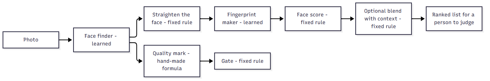
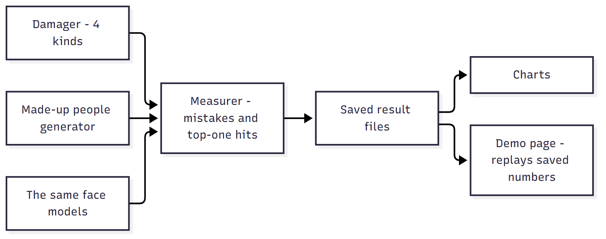
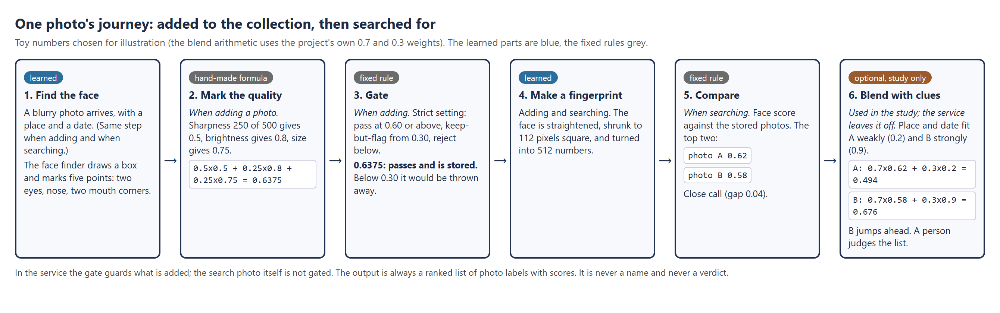
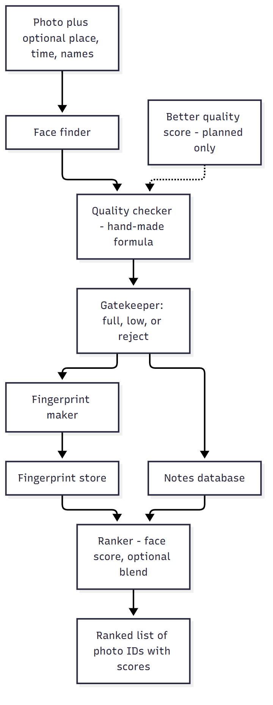
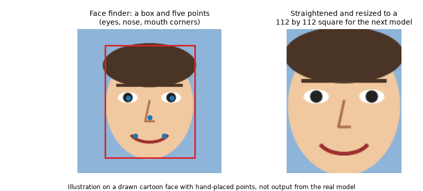
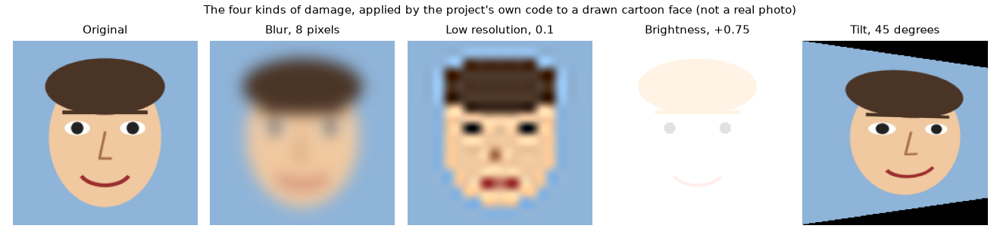
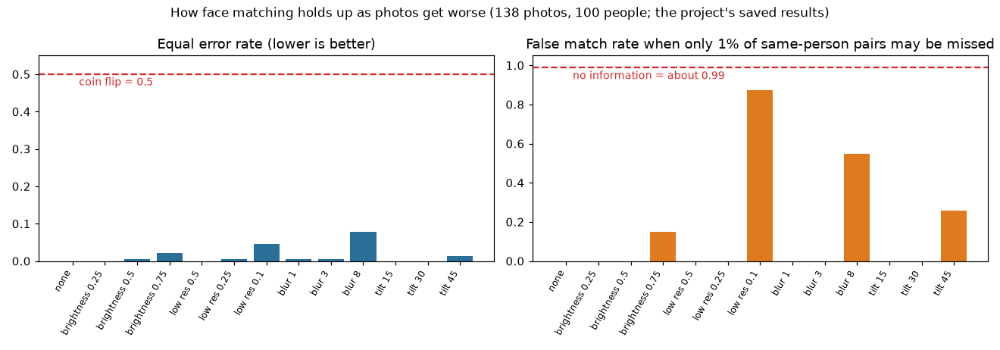
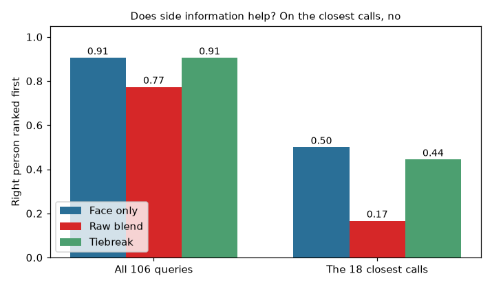

# Grey-Resolve

*A study of whether side clues can tell apart two look-alike faces in bad photos, with a small face-search service built to test it.*

Status: a finished research prototype, last changed in October 2026. Code: https://github.com/PCSchmidt/Grey-Resolve (code under the MIT licence; the face models have their own non-commercial terms). A static demo page is public at https://pcschmidt.github.io/Grey-Resolve/.

I built Grey-Resolve to answer one question. When a photo of a face is poor (blurry, tiny, too bright or taken at an angle) and two different people look alike to a computer, can extra clues such as where and when the photo was taken settle which person it is? On the made-up clues I tested, I found no evidence that they help, and in one test they made things worse. The project is mostly the careful measuring that led to that answer.

Grey-Resolve is a set of fixed rules wrapped around two learned face models.

The everyday version: imagine a security analyst with a smudged photo and a folder of earlier photos. A face-matching program says two folder photos are almost equally good matches. The analyst would naturally ask, "Which of them was seen near that place around that date?" Grey-Resolve tests whether a program can use that kind of clue, and whether it can know when it should not try. It returns a ranked list of candidates for a person to judge, never a name, and it has no real users. Defense-sector topics interest me. AI coding agents wrote almost all of the code, while I directed the scope, plan, architecture and preferences.

Here is what is fixed and what is learned. A calculator is deterministic: the same input always gives the same answer. A weather forecast is probabilistic: it is a best guess that can be wrong. Grey-Resolve is a mixture. The two face models are the probabilistic part. They learned their skill from a large collection of example photos. What they do depends on that training, and they can be wrong in ways nobody wrote down. The similarity scores they produce are not probabilities.

Everything around the models is deterministic. The same input gives the same answer every time. That covers the quality formula, the gate that accepts or rejects photos, the score arithmetic, the error-rate maths and the code that damages photos. Chance enters in three places. The quick search method is approximate, so it can occasionally miss the true closest match. The made-up clues come from a random generator. And the samples are small: one headline result rests on only 18 test searches.

To keep chance in check, the project fixes the generator's starting number (a "seed") so the made-up data is the same on every run. It keeps an exact but slow search as a referee for the quick one. It uses a quality gate that turns away the worst photos. It counts failures instead of hiding them. It compares every result with a plain face-only baseline. And its output is a ranked list for a person, never a decision.



The one idea that makes the project work is measuring before trusting. Every step is tested against that plain baseline, and the result that clues do not help is reported as a result. If you have ten minutes, read the chapters on what it does, the results, and the strengths and shortcomings.

In short, Grey-Resolve is a measured study with a small search service attached, and I found no evidence that clues help on this data.

## What problem this solves

Face matching works well on good photos. Passport-style pictures are easy: a modern program rarely confuses two people. Real collections of pictures are not like that. They hold small, blurry, dark or sideways faces, and there the program gets less certain and its top two or three guesses can score almost the same. Someone who has to decide between those guesses is in a grey zone: the evidence is thin and a wrong call has a cost.

The people who would have this problem are analysts who work through large piles of imagery. The project's README (the front-page description of a code project) gives defense intelligence as the motivation. Today they would rely on their own eyes and whatever notes came with each picture. The project is aimed at that kind of reader, but only as a research tool: it is not deployed, and nobody else is shown to use it.

Two questions drive the work. First, how badly do the matching scores fall apart as photos degrade, and can a quality check keep the worst photos out? Second, when two candidates are nearly tied, does information such as place, date and names mentioned nearby help pick the right one? The plan defines success as numbers from a repeatable command, including an honest report of anything that did not work. Such numbers exist for both questions. One thing the plan hoped for, that the quality check would lower false matches (different people wrongly judged to be the same), could not be tested on this data, and the project says so.

Face-matching software already exists, so Grey-Resolve is not trying to be a better matcher. It is a small, open test bench with its own damage tests and a written record of what failed, and it is far less capable than any real product. A skeptic would ask, "Why not just use a face-matching service?" A service would give a better matcher, but not the measurement this project is for.

The project deliberately avoids several things: scraping real social media, recognising people by their walk or body, watch-list language, and any real people or real intelligence data. It is a ranking tool, and the README says ranking is not authorisation. The only real face photos it touches are research photos kept locally and never committed to the repository.

In short, the project asks a narrow, useful question about bad photos and near-ties, and it is a test bench, not a product.

## Where the project came from

Grey-Resolve grew out of a course project of mine called IronClad. I did it for JHU (Johns Hopkins University) course 705.603, Creating AI-Enabled Systems, in the module on searching collections of number lists. IronClad is a door-access service for an imagined defense company: a camera photo of a person at the door is turned into a list of numbers and compared with the enrolled employees, and the service returns the closest candidates.

The course supplied the skeleton and the two parts that turn a photo into numbers: a face-matching network of the FaceNet style (FaceNet is the name of an earlier well-known face-matching method) and MTCNN (Multi-task Cascaded Convolutional Networks), a small learned program that finds and crops the face first. I wrote the rest, mostly with Claude Code as my assistant, making decisions as the project was built out. That meant three ways of searching the stored number lists with FAISS (Facebook AI Similarity Search), a library for fast search over lists of numbers; the add-and-identify service; the tests; the Docker packaging (Docker bundles a program with everything it needs so it runs the same elsewhere); and a five-part design report on questions such as which network to use and how many candidates to return. The course's automatic grader gave it full marks, 120 out of 120.

Grey-Resolve is a separate, later project. Its own documents say it was adapted from that coursework and re-scoped around the way serious systems are evaluated. The README calls it an independent implementation in which course code informed the design, and the architecture notes describe its search index as a port of IronClad's. A port inventory in the repository lists, file by file, what could carry over and what had to be rewritten.

The differences are the point. IronClad used a FaceNet-style network and MTCNN; Grey-Resolve uses ArcFace and a different face finder, both explained in the models chapter. IronClad judged a photo by how confident the cropper was; Grey-Resolve has its own quality formula. IronClad asked how many candidates to return; Grey-Resolve asks how often a match is right or wrong as photos degrade. IronClad's report already tested photos made worse with blur, shrinking and brightness changes; Grey-Resolve keeps that idea, adds a tilt test, and then adds what IronClad did not have: made-up clues and a blend of face score with clues. Its web service uses FastAPI (a Python toolkit for web services), and its photo notes live in SQLite (a database stored in one file). The evidence runs also borrow IronClad's course photo collection, which is research data and is not in the Grey-Resolve repository.

In short, Grey-Resolve is IronClad's descendant: the same family of idea, a newer face model, and a very different question.

## What it does, step by step

Grey-Resolve does two jobs. As a small service it accepts a photo (with an optional place, date and names), stores a "fingerprint" of the face, and later answers "which stored photos look most like this one?" with a ranked list of scores. As a study, it takes a set of photos, damages them in controlled ways, and measures how the matching holds up and whether clues help. The service and the study share the same face models but are separate programs, and only the study uses the clues.



Here is one photo's journey through the service, using toy numbers. A blurry picture arrives. A face finder draws a box around the face and marks five landmarks, the points where the eyes, nose tip and mouth corners are. A hand-made formula gives the face a quality mark between 0 and 1; say 0.64. The strict setting accepts anything from 0.60 up, so the photo is accepted. The face is straightened and turned into a fingerprint of 512 numbers. Later, someone searches with a new photo of the same person. Its fingerprint is compared with the stored ones, and the closest two come back: photo A with a score of 0.62 and photo B with 0.58. That is a close call. In the study, the clues are then blended in, and if they fit B much better than A, B can jump ahead. Whatever order comes out, a person has to judge it.



The best everyday comparison is a library desk with a doorman. The doorman looks at each book handed in and turns away the ones too torn to read (the quality gate). The librarian files a short summary card for each accepted book (the fingerprint). When you bring a damaged page and ask where it came from, the librarian pulls the cards that look most like it. A note on each book's shelf date and location might help choose between two close cards. The comparison breaks down because a library card is a plain summary, while a face fingerprint comes from a learned model that can be fooled.

The intended user is a reader of the results. The service has no screen for ordinary people. There is only the public demo page, which replays saved numbers on made-up contacts and shows no real faces. Everything is automatic except the final judgment of the ranked list, which the project leaves to a person. Use in a government or defense setting would need much more, none of which exists here: approved data, a protected setup, sign-in, logs and a way to run with no internet.

In short, a photo goes in, a ranked list of look-alike photos comes out, and the project's interest is in how much to trust that list.

## The parts, the data and the rules

The service is built from a handful of parts, each with one job. The face finder locates faces and their five landmarks. The quality checker scores each face. The gatekeeper uses that score to accept a photo fully, accept it with a low-trust flag, or reject it so it is never stored. The fingerprint maker turns an accepted face into 512 numbers. The fingerprint store, which the project calls an index (a collection built so the closest matches can be found fast), holds them. A notes database keeps each photo's label, quality mark and clues, and a ranker orders the results. A separate study side holds the damage code, the made-up people generator and the measuring code.



The dashed box is a planned part: the plan mentions a learned quality score to replace the hand-made formula, but it was not built.

Several rules are enforced in the code, and they exist to keep bad data out of the collection. A rejected face is never stored. Every fingerprint has a unique number. A duplicate, a wrong-size list or an all-zero list is refused with a clear error, since any of them would corrupt the searches. Nonsensical settings are refused too. Extra checks written for the Evidence Notes found these rules hold, apart from the gaps listed in the testing chapter.

The data comes in four kinds. First, real face photos: roughly 260 photos of 200 people, up to two photos each, from the course photo collection I used in IronClad. The repository's documents describe it as derived from LFW (Labeled Faces in the Wild), a public research set of photos of well-known people. It is research-only and kept outside the repository, so the headline numbers cannot be repeated without a similar photo set. Second, made-up people and clues: a seeded generator invents "personas" (fake people with place labels, platforms, names and dates in 2024) and attaches them to the real photos, so the project can test clues without real information about anyone. Third, deliberately damaged photos, produced by the project's own code. Fourth, 17 small saved result files holding only totals, which the demo page replays.

The service keeps fingerprints in memory and, as the code stands, never saves them to disk, so a restart empties the collection. The notes database is a file and survives. The code is Python, about 5,600 lines for the main package and 4,000 for tests. The fingerprint store uses FAISS, described earlier, and the face models run on an ordinary processor with no graphics card.

The weakest link is the gap between the checks and real photos: the service has never been run end to end on a real face in the project's own tests. If the collection grew a hundredfold, the first things to break would be the single lock around the notes database and the missing saving of the index; the fast search itself is built for large collections.

In short, the parts are simple and well separated, and the data is real faces kept private plus made-up clues that are public.

## The methods and the arithmetic

Most of the thinking in this project sits in a few small methods, taken here in the order a photo meets them.

**Comparing two fingerprints.** A fingerprint is a list of 512 numbers. To compare two, the project uses cosine similarity, which measures whether two lists point the same way, like two compass needles. Toy example with two numbers instead of 512: the lists (1, 0) and (0.8, 0.6) point about 37 degrees apart and score 0.8; (1, 0) and (0, 1) point at right angles and score 0. For real faces, different people usually score near 0 (in the study data, 98 of every 100 different-person pairs scored below about 0.13) and photos of one person score far higher. The score is a similarity, not a probability: 0.62 does not mean "62 percent sure".

**The quality mark.** The project's own formula, which it calls a lightweight stand-in for a real face-quality model, gives half the mark for sharpness (how much neighbouring pixels differ, capped at a reference level), a quarter for how well lit the face is, and a quarter for its size. Toy example: sharpness 250 against a reference of 500 gives 0.5; a face of average brightness 0.6 gives 0.8; a face 60 pixels wide, against 80 for full marks, gives 0.75. The mark is 0.5 x 0.5 + 0.25 x 0.8 + 0.25 x 0.75 = 0.6375. The strict setting accepts from 0.60, keeps with a low-trust flag from 0.30, and rejects below that. The formula has a known flaw: a picture of random noise scores about 0.999, because noise looks very "sharp" to it.

**Finding the closest fingerprints quickly.** Comparing a new fingerprint with every stored one is exact but slow. The project uses HNSW (Hierarchical Navigable Small World), a search shortcut in the FAISS library that finds close matches without comparing against everything. Think of finding a friend's house in a big city: you start on a main road, hop to the neighbourhood that looks closest, then the street, then the house. HNSW builds a layered map of such connections so each search visits a small part of the collection. It is approximate, so it can miss. An exact brute-force search sits beside it as the referee. In the project's speed test, 95 of every 100 searches over 50,000 fingerprints finished within 1.6 thousandths of a second, against 21 to 29 thousandths for the exact search (three runs). That test used random fingerprints, on which the shortcut finds few of the true closest, so I do not treat the speed figure as evidence of accuracy.

**Counting mistakes.** To judge a matcher you first need a cut-off (also called a threshold): the score above which two photos are called the same person. A pair is simply two photos being compared. A cut-off can go wrong in two ways. FMR (False Match Rate) is the share of different-person pairs wrongly accepted as the same, which I will also call "impostors let in". FNMR (False Non-Match Rate) is the share of same-person pairs wrongly rejected. A tiny test in the project shows both. Four pairs score 0.9, 0.8, 0.4 and 0.3, and the first and third are same-person pairs. With a cut-off of 0.5, the different-person pair at 0.8 is wrongly accepted, so FMR is 1 in 2, or 0.5. The same-person pair at 0.4 is wrongly rejected, so FNMR is also 0.5. Moving the cut-off trades one error for the other. EER (Equal Error Rate) is the error where the two meet; a coin flip gives 0.5 and perfect separation 0. A stricter summary sets the cut-off so only 1 in 100 same-person pairs is missed, then asks how many impostors get through. A matcher that knew nothing would let in about 99 of every 100.

**Clues and the blend.** Each stored photo can carry a place label, a date and a few names. The clue score compares a search photo's clues with a candidate's, using only the kinds of clue both photos carry (and giving 0 if they share none): a matching place counts 0.4; a date counts 0.3 and halves for every 30 days apart; overlapping names count 0.3, scaled by how much the two name sets overlap. Toy example: same place (1.0), dates 15 days apart (0.707), names {a, b} against {b, c} (one shared of three, 0.333) give 0.4 + 0.21 + 0.10, about 0.71. The "blend" is 0.7 x face score + 0.3 x clue score. Toy example: photo A has face 0.62 and clue 0.2, giving 0.494; photo B has face 0.58 and clue 0.9, giving 0.676, so B overtakes A. With these weights a full clue swing can overrule a face gap as large as 0.43.

Because the blend turned out to hurt, the project added two safer versions. The "selective blend" blends only when the top two face scores are within 0.1. The "tiebreak" is stricter: it keeps the face order, except that when the top two are that close and the search photo has clues, it swaps them if the blend prefers the second.

**The formula, if you want it.** Face similarity: cos(a, b) is the sum of the products of matching entries of lists a and b, divided by the product of their lengths. Blend: P = 0.7 x S_face + 0.3 x S_clue, where S_face is the face score and S_clue the clue score, both between 0 and 1.

The headline measure for the clue study is "right person first": the share of searches in which the right person is ranked first. Guessing among 60 candidates scores about 0.017; the fairer comparison is the face-only ranking, repeated in every table.

In short, nothing here is exotic: a similarity score, a hand-made quality formula, a graph search, error counting and a weighted blend, each small enough to check by hand.

## The face models and what they do

Grey-Resolve uses two learned models, both borrowed and both run unchanged. There is no language model and no prompt anywhere in the project. A model here means software that learned its skill from examples; its "weights" are the saved numbers that hold what it learned. The learned parts only suggest. They produce a box around a face and a fingerprint, and everything that decides what to do with those is a fixed rule.

**The face finder: SCRFD.** SCRFD (Sample and Computation Redistribution for Efficient Face Detection) is a network trained on photos in which people have marked where the faces are. The project uses the version shipped in a bundle of models from InsightFace, an open-source toolkit for face analysis. A photo goes in, resized to fit a 640-by-640 frame. Out come, for each face, a box, a confidence between 0 and 1 and the five landmarks. The project keeps faces above a confidence of 0.5 and works with the most confident one. The earlier IronClad work used MTCNN for this job. The repository gives no reason for choosing SCRFD over it beyond its coming in the same bundle as the fingerprint model. Where it fails: when a photo is badly damaged it finds no face at all, which happened for 42 of 138 test photos at the brightest setting, 19 at the smallest size, and 12 at the strongest blur.



The picture is an illustration on a drawn face with hand-placed points, not output from the real model. After finding the landmarks, a fixed geometric rule from the InsightFace library rotates, scales and crops the face to a standard 112-by-112-pixel square. That step is not learned; the code comments say a fallback that crops by the box alone is measurably worse.

**The fingerprint maker: ArcFace.** ArcFace (Additive Angular Margin Loss for Deep Face Recognition) is both the name of a training method and, loosely, of the networks trained with it. The project uses the InsightFace version, a 50-layer network trained on WebFace600K, a large collection of face photos for research use. A straightened face goes in; out come 512 numbers, scaled to length 1, which are the fingerprint. In everyday terms it learned from many photos of many people, rewarded when two photos of one person gave fingerprints pointing the same way and photos of different people pointed apart. The "angular margin" in the name means training demanded a wider gap between different people than merely correct.

The plan records why this model: among four families of face models it compared, InsightFace was the only one with an explicit, signed grant for non-commercial research use of its weights. Two of the others stay as named alternatives. AdaFace is a model made for low-quality photos, kept as a planned fallback with unclear weight terms. MagFace is a model whose internal "magnitude" can double as a quality score, planned but not built. IronClad's FaceNet-style network is the other obvious alternative. No head-to-head test of face models was run, so any claim that one is better rests on the licence review, not on measurements.

Both models run on an ordinary processor, cost nothing per use and need no internet once downloaded. The weights are a bundle of about 289 megabytes, fetched at run time by a script and never committed to the repository. The script does not check the download against a known checksum (a short fingerprint of the file that would show it was altered). The weights are licensed for non-commercial use only.

What the models get wrong is the subject of the study. Under heavy damage the same person's fingerprints drift apart, so true matches look less certain while different people also start to look alike. The README warns that face matching degrades on some demographic groups, heavy occlusion and extreme pose; group fairness was not measured. In the test suite only three tests load the real models, feeding them random-noise pictures to check that they run; their real testing is the damage study with real photos.

The safeguards around the models are the fixed parts: the quality gate, thresholds, the counting of failures to find a face, a face-only baseline for every claim, and the rule that output is ranking, never identification. The human check is advisory: nothing in the code forces a person to review a list.

In short, two borrowed networks do the learning (find the face, make the fingerprint) and fixed rules do all the deciding, so the study is about how far those rules can protect against the models' weakness on bad photos.

## Testing, damage and edge cases

The study damages photos in four ways, each with its own strength knob. Blur smears the picture (strength is the width of the smear in pixels). Low resolution shrinks the picture and blows it back up (the strength is how much of the resolution is kept, so 0.1 keeps a tenth). Brightness adds a fixed amount of light, washing the picture out. Tilt squeezes one side to imitate a face turned away, much as a camera on an angle would see it.



The picture uses a drawn face because the real photos are research data and cannot be shown. The tilt test is a squeeze, not a spin in the picture plane, which the project's write-up calls rotation in one place.

The program's own protections are mostly input checks: out-of-range settings, empty pictures, not-a-number scores and zero-length fingerprints raise clear errors, bad uploads return an error, results per search are capped at 100, and a failure to find a face is counted, never a crash.

Extra checks written for the Evidence Notes tried to break the rules stated earlier, and most held: the gate sorts every boundary score correctly, duplicate or malformed fingerprints are refused, and the error-rate functions refuse inputs that cannot give a meaningful rate. Four holes turned up, and I list them here once. After a restart the service numbers fingerprints from zero again while the notes database still holds old rows, so a new photo can overwrite an old photo's notes. If saving notes fails after the fingerprint is stored, an orphan fingerprint (one with no notes) is left behind. Mixing a date with a time zone and one without stops the blend code with an error, though only when blending is on, which the service never does. And a photo of pure noise gets a near-perfect quality mark.

There are 241 automated tests in 15 files, and all pass once one package that the project forgot to list (needed by the web tests) is installed; without it, 12 tests fail. A second maths package, SciPy, is also used but unlisted. The tests for the pipeline and web service use stand-in face models, since no real faces are in the repository. The error-rate tests use tiny cases worked out by hand, like the four-score example earlier. About 95 percent of the main code is touched by the tests. What no test covers is a real face end to end through the service, a restart, a half-failed save, mixed time zones or Docker. The project has no automatic run of the tests on each change.

The weakest point for trust is how the results were planned. The plan was written first and committed on the first day, and it promised to report negative findings. But it was a plan, not a locked protocol with success thresholds, and later designs (the changed near-tie band, the selective blend, the tiebreak) were created after seeing results and tested on the same photos and seed. There is no "held-out" test, meaning one run once on photos kept aside and never used for tuning. So the numbers are best read as careful descriptive measurements, not as proof on unseen data.

In short, the damage tests are carefully constructed and the code is checked in many small ways, but nothing was tested on fresh data or on a real face through the service.

## Does it work? The results

There are three results: how matching degrades, whether the quality gate helps, and whether clues help. Each comes from one run on private research photos, with no repeats and no ranges in the project's own write-up.

**How matching degrades.** The first test used 138 photos of 100 people. Each photo was damaged and compared with the clean photos. The table shows the worst setting of each damage. The equal error rate (0.5 would be a coin flip, 0 perfect) stays low almost everywhere. The strict measure is what climbs: the share of impostor pairs let in once the cut-off is set so only 1 in 100 same-person pairs is missed.

| Damage, strongest setting | Equal error rate | Impostor pairs let in at a strict cut-off | Photos where no face was found (of 138) |
| --- | --- | --- | --- |
| None (clean) | 0.000 | 0.000 | 1 |
| Brightness +0.75 | 0.022 | 0.149 | 42 |
| Tilt 45 degrees | 0.014 | 0.256 | 1 |
| Blur 8 pixels | 0.078 | 0.547 | 12 |
| Low resolution 0.1 | 0.046 | 0.873 | 19 |
| A matcher that knows nothing | 0.5 | about 0.99 | not applicable |



The lesson: ranking people correctly and choosing a safe cut-off are different problems. At the lowest resolution the program still ranks pairs well (equal error rate 0.046), but a cut-off tuned to miss almost no one would let in 87 of every 100 impostor pairs. One caution applies to all of these numbers: most same-person pairs in this test compare a damaged copy of a photo with the clean copy of that very photo (137 of 213), which flatters the scores. 62 of the 100 people have only one photo.

**The quality gate.** The gate keeps only photos with a quality mark of 0.5 or more. On clean photos it lowered the share of true matches missed from 0.028 to 0.020 (6 of 213 pairs against 4 of 199) while accepting 94 percent of photos. Under blur 3 the miss rate fell from 0.127 to 0.000, but only 9 percent of photos passed, so that rests on 12 photos. The plan hoped it would also lower false matches, and that could not be shown because the first test never produced a single false match at its cut-off. The write-up omits one row where the gate did not help: at low resolution 0.1 its few remaining photos all missed.

**Do clues help?** This is the central question, tested on made-up people. In the first run on clean searches the face alone already ranked the right person first every time, so clues had nothing to fix. The interesting case is a damaged search photo (low resolution 0.1) where two people score within a hair of each other. A first small run seemed to show clues helping: in the 4 tightest searches the right person went from first in half to first in three quarters. At double the size the effect reversed. The table shows the larger run: 106 searches among 60 made-up people, where guessing would get the right person first about 1 time in 60. The "closest calls" are the 18 searches where the top two face scores were within 0.05 of each other.

| Method | Right person first, all 106 searches | Right person first, the 18 closest calls |
| --- | --- | --- |
| Face score only (the baseline) | 0.906 | 0.500 |
| Blend of face and clues | 0.774 | 0.167 |
| Tiebreak (clues only to swap the top two) | 0.906 | 0.444 |



Blending everything made things worse, especially in the closest calls, where it fell from 9 correct in 18 to 3 in 18. Because 18 is a small sample, a confidence range (the span of true rates the sample could plausibly come from) is wide: about 0.29 to 0.71 for 9 of 18 and about 0.06 to 0.39 for 3 of 18. The selective version still cost 0.057 overall (0.849). The tiebreak removed the damage and did not help: on the closest calls it lost one search of 18, within noise. The project's diagnosis is that the clues are real but weak. A check on the same generator, done for the Evidence Notes, found that a true match's clues beat a random rival's clues about 91 percent of the time when both photos had clues, but only about 55 percent of searches carried clean clues, and a blend over 59 rivals picks up extreme values from chance. So the claim that clues break face ties is not supported on this data, and the project says so. With a single run, 18 close calls and made-up clues, this is a lack of evidence for benefit, not proof that clues can never help.

The README, plan and results notes make 38 checkable claims; 17 hold up, 9 hold only in part, and the rest are wrong, unsupported or were not checked. The ones that matter most are described in the shortcomings chapter, and the full list is in the companion Evidence Notes. Others could repeat the results only with their own photo set, the saved commands and the fixed seed.

In short, the measurements show where face matching breaks, but they are one-off numbers on a small private photo set, and the hope that clues would help was not borne out.

## Could it be put into real use?

No part of this has been operated for real users. The service has only run on a development computer. The only thing reachable by the public is the demo page, a static site that replays saved numbers on made-up contacts. GitHub shows no stars, no copies and two page views in two weeks. Put on a simple ladder (experiment, works on one machine, ready to deploy, operated for users), Grey-Resolve is on the second rung: it runs and passes its tests on one machine, and a Docker setup is written for it but was not built for the Evidence Notes.

Against the usual production habits the picture is mixed. Quality is measured against a simple baseline, though without ranges. Failure handling is partial: bad input is refused and missed faces are counted, but there are no time limits, no upload size limits and no undo for a half-failed save. There is no logging beyond a health check. A pattern scan found no secrets in the code or its history, but there is no sign-in and stored face data is not encrypted. Human review is by convention only. A newcomer could nearly run it from a clean start, but the install steps leave out two packages and versions are not locked, so 12 of the 241 tests fail on the first run.

What does mirror real practice: a baseline before every claim, failures counted rather than hidden, a design change after a measured failure (the tiebreak), a written licence review before choosing a model, and model weights kept out of the container image.

To deploy it for real users it would need hosting, sign-in and limits, saving of the fingerprint collection, logging and alerts, a way to roll back a bad release, fixed model versions, a security review, a written operating guide and, above all, a resolution of the model licences, since the weights are for non-commercial use. As a showcase it is a possible candidate rather than a strong one: good on evaluation habits, weak on deployment, and hosting a face-matching service publicly would be unwise and licence-limited.

In short, Grey-Resolve works on a laptop and as a public demo of saved numbers, and that is all it should be taken to be.

## Strengths, shortcomings and the work still to do

The strongest thing about the project is how it treats its own results. Every claim is set against a plain baseline. Detection failures are counted instead of discarded. A positive result that did not survive scaling up was written down with the reversal, and a safer design was built in response. The licence review kept private photos and non-commercial model weights out of the public repository.

The shortcomings fall into three kinds. The defects are the four holes already described in the testing chapter. The gaps are things left out: no check on a real face through the service, no confidence ranges, no sign-in, no automatic test run, and an experiment meant to tune the blend weights whose result was never saved. The deliberate limits are stated in the plan: no real data, no scraping, no body recognition, no real-world accuracy claim.

Three shortcomings matter most. The headline numbers are flattered, since many test pairs compare a photo with its own damaged copy, the photo set is small and private, and there is a single run. The documents overstate in places: the tiebreak is called "provably safe" when there is only measurement; a tested data move between the two kinds of fingerprint store is claimed but cannot work; a description on GitHub mentions entity-recognition and "persons of interest" features the code does not have; and a results label names a run file that does not exist. And the project is not repeatable from the README alone, because of the missing packages, unlocked versions and absent test run.

The fixes are small: recompute the numbers on pairs of different photos with ranges, correct the wording, declare the packages and add an automatic test run. Promised versus built is mostly good: the core search, notes, measuring, damage and blend code is done and tested. A learned quality score, an alternative face model, hard-pose tests and confidence ranges were planned and not built. The plan's main unmet promise, that the gate lowers false matches, is disclosed as unmet.

Is it worth finishing? It looks worth tidying and freezing rather than extending: declared packages, a test workflow, a saved index, corrected wording, then honest recomputed numbers. Only new clue features or real multi-photo data would justify reopening the science. It runs free on a laptop; setup needs Python 3.12 and a download of about 289 megabytes of model files. The main risks are unprotected face data and the weights' licence, and a careful reviewer would add sign-in and limits first.

In short, the project is honest and mostly sound, its flaws are small and fixable, and the best next step is repair and freeze, not expansion.

## How it was built, and who did what

AI coding agents wrote almost all of the code, and I directed the scope, plan, architecture and preferences. I did not write the code by hand, and I do not claim to have. The repository does not say which agent tools were used: only two of its 41 commits carry any AI credit line, and there are no agent instruction files in it.

The plan, written on the first day, records the decisions I directed: the face model chosen on licence clarity, a hand-made quality score first with a learned one later, FastAPI for the service, SQLite for notes, the MIT (Massachusetts Institute of Technology) licence, a permissive open-source licence, and the explicit cuts (no scraping, no body recognition, no real people). The plan also fixes what "done" meant: repeatable measurements, honestly reported, including negative ones. The plan, architecture and results documents record these decisions.

The history shows the build correcting itself. The near-tie band the plan guessed was found empty and replaced with a measured one; a ranking-order bug in the tiebreak reporting was fixed 42 minutes after it was introduced; and a small-run positive result was recorded and then reversed when the run was doubled. One commit message says plainly that a batch of agent output had "validation pending". All the work landed in a few days in early October 2026, with a final documentation commit on October 19.

In short, I steered and judged and the agents typed, and the history shows a build that checked itself and corrected course.

## For recruiters and interviewers

**In thirty seconds.** I directed AI coding agents to build a face-search test bench called Grey-Resolve and used it to measure two things: how face matching breaks as photos get worse, and whether made-up side clues can settle near-ties. I found no evidence that the clues help, and the project reports that plainly. **In two minutes**, add that it uses two borrowed face models, hand-made quality and blending rules, a quick graph search, 241 tests and a public demo of saved numbers, grew from my Johns Hopkins course project IronClad, and has never run for real users.

**What it demonstrates.** Evaluation habits (baselines, counted failures, a reversed result recorded), system design in small parts, safety thinking (ranking, never identification; licence review; no real data), and directing AI agents with a written plan. It does not demonstrate production operation, working on a team, scale, being on call, or building from scratch live.

| Typical requirement | What the project shows | Strength | How to say it honestly |
| --- | --- | --- | --- |
| Metric-driven evaluation | Baseline-first tests, counted failures, negative results | Demonstrated, one run | "I measured it against a simple baseline and reported what failed." |
| Choosing models and trade-offs | Written licence comparison of four face-model families | Partly | "I chose on licence terms; I did not compare accuracy." |
| Vector search and data stores | Graph search through FAISS, an exact referee, a notes database | Small scale | "Built and timed on up to 50,000 test vectors." |
| Testing and automatic checks | 241 tests using stand-in models; no automatic runs, no logging | Partly | "Tested locally; no pipeline yet." |
| Human review of AI output | Output is a ranked list for a person | Partly | "Advisory by design, not enforced." |
| Deploying and monitoring | Docker files written; static demo online | Simulated | "I have not operated this for users." |
| Agentic or language-model workflows | None; no language model | Not shown | "This project is about face models, not agents." |

The closest role family is ML or AI engineer with an evaluation focus, and even that fit is partial since there is no training or monitoring. The weakest fit is the applied language-model and agent role.

**Five likely questions.**
1. *What is the project in a sentence?* A face-search test bench that measures how matching breaks on bad photos and whether side clues help; I found no evidence they do.
2. *A decision that turned out wrong?* A small run showed clues helping in 4 searches; at 18 the effect reversed. What would have caught that earlier is a larger first run.
3. *How do you know it works?* Baselines, counts and 241 tests, but one run on a small private set, so the numbers are descriptive.
4. *How did you use AI tools without losing quality control?* A written plan, a baseline for every claim, many tests, and corrections visible in the history.
5. *Why ArcFace and not FaceNet?* The plan chose the InsightFace bundle for its clear licence; there was no head-to-head accuracy test.

**Three tough questions.** *Is it a wrapper around someone else's models?* Partly: the two face networks are borrowed; the damage tests, scoring, blend, measurements and service are the project's. *If agents wrote the code, what did you do?* Directed scope, plan and architecture, and judged results. *Have you run this for real users?* No.

**Five-minute demo.** Open the public demo page and say it replays saved numbers on made-up contacts; show the damage chart; show the blend failing on the closest calls; end on the "not supported" line in the results notes.

**What not to exaggerate.** It is a measured study, not a product. The accuracy numbers are on research photos, not real-world data. The demo is scripted. I did not write the code by hand.

In short, the project shows careful evaluation and honest reporting with AI-directed engineering, and it does not show production operation.

## Glossary

- **ArcFace (Additive Angular Margin Loss for Deep Face Recognition):** a way of training a face network so that different people's fingerprints sit well apart; also used for the networks it produces.
- **Baseline:** a plain method used as the yardstick, here the face-only ranking.
- **Cosine similarity:** how closely two lists of numbers point the same way; 1 is identical, 0 unrelated.
- **Cut-off (threshold):** the score above which two photos are called the same person.
- **EER (Equal Error Rate):** the error rate at the cut-off where false matches and false non-matches are equally common.
- **FAISS (Facebook AI Similarity Search):** a library for fast search over lists of numbers.
- **Fingerprint:** the 512 numbers a face network produces for a face.
- **FMR (False Match Rate) and FNMR (False Non-Match Rate):** the share of different-person pairs wrongly accepted, and of same-person pairs wrongly rejected.
- **Gate:** the rule that accepts, flags or rejects a photo by its quality mark.
- **HNSW (Hierarchical Navigable Small World):** a layered map of connections that makes nearest-neighbour search fast but approximate.
- **Index:** a collection of fingerprints built for fast searching.
- **Near-tie:** two candidates whose face scores are almost equal.
- **Persona:** a made-up person with fake place, name and date clues attached to real photos.
- **SCRFD (Sample and Computation Redistribution for Efficient Face Detection):** the face-finding network.
- **Tiebreak:** using clues only to decide between the top two candidates when they are very close.

## Where to look in the code

This list is for engineers; other readers can stop here.

```
Grey-Resolve/
  src/grey_resolve/   the package: detection, embeddings, index, fusion, degradation, scenario, evaluation, plotting, api
  benchmarks/         command-line studies (evaluate_roc, evaluate_fusion, latency_profiler, make_figures)
  configs/            search settings, operating profiles, scenario settings
  docker/             Dockerfile, compose file, serve.py (service entry point)
  docs/               RESULTS.md, saved result files, figures, demo page
  scripts/            fetch_backbone.py (downloads model weights) and run recipes
  tests/              15 test files, 241 tests
```

Start-up points: `docker/serve.py` for the service, `benchmarks/*.py` for the studies, `docs/index.html` for the demo. Install per the README (Python 3.12, extras for search, face models, service, figures), then add `python-multipart` before running `python -m pytest -q`; with that, all 241 tests pass. Five files to read first: `src/grey_resolve/pipeline.py`, `fusion/linear.py`, `evaluation/fusion_experiment.py`, `evaluation/metrics.py`, and `docs/RESULTS.md`.
