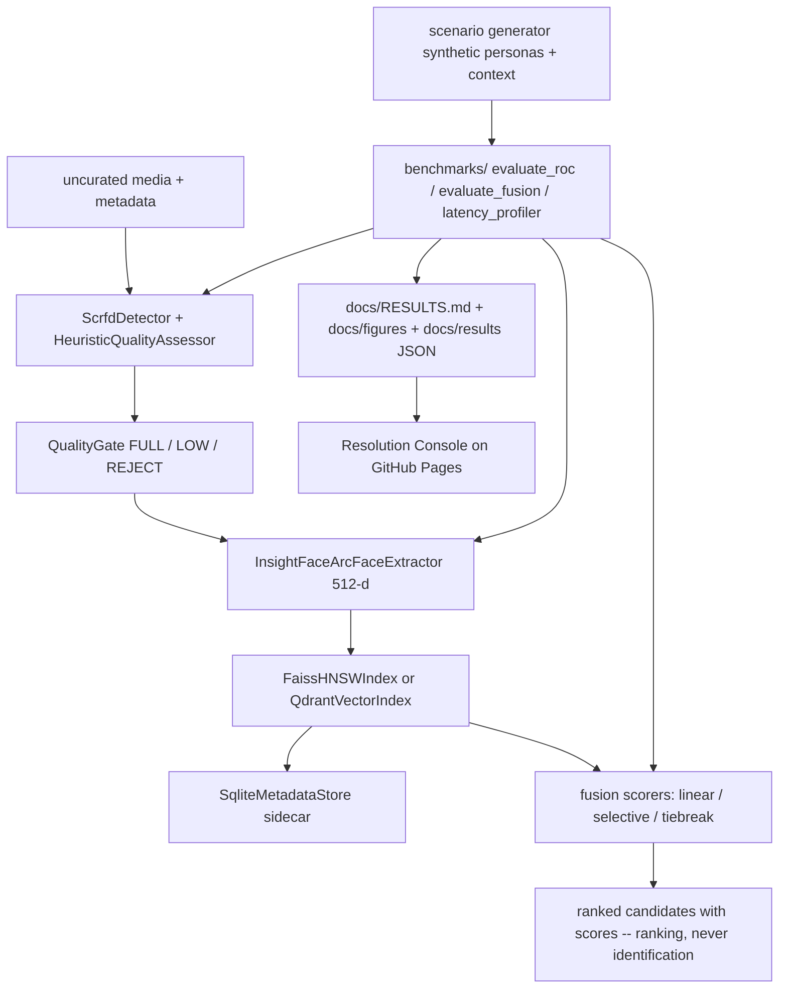
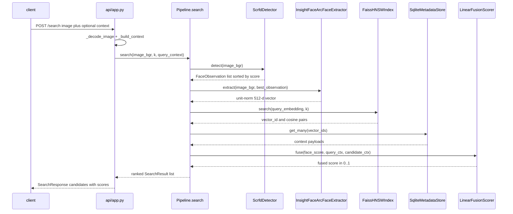

# Grey-Resolve — Master Explainer

Repo: <https://github.com/PCSchmidt/Grey-Resolve> · Live demo: <https://pcschmidt.github.io/Grey-Resolve/> (HTTP 200, synthetic banner, checked 2026-10-18) · License: MIT (code); model weights non-commercial, never redistributed · Last commit: 2026-10-09 (`4e29476`)
Status: research prototype / portfolio study (`0.1.0.dev0`) · active burst 2026-10-06 → 2026-10-09 (40 commits); "paused or done" [Unknown]
Explainer generated: 2026-10-18 by an AI agent under Chris Schmidt's direction · Questionnaire v1.1 · Depth: LITE (LITE run)

> Tags: **[Verified]** seen in code/config/tests/commits (cited `path`, function, SHA); **[Documented]** stated in a committed doc or an untracked workspace run log (cited); **[Author]** confirmed `AUTHOR_CONTEXT.md` line (⚠ lines = [Inferred]); **[Inferred]** reasoned (rest-on stated); **[Proposed]** not in the repo; **[Unknown]** → §26. **This run performs no execution** (run brief): nothing is [Measured]; outcomes come from `docs/results/*.json`, `docs/RESULTS.md` and untracked workspace logs (`bench_run*.log`, `fusion_run*.log` in `C:\Dev\AIEngineeringProjects\Grey-Resolve`, tagged [Documented, untracked]). Claim levels L1/L2/L3 defined in §11. One fact, one home; cross-referenced by ID (CL-…, W-…, D-…, §n).

## TL;DR

**V.1** Grey-Resolve resolves face identity over degraded, uncurated media — detect, quality-gate, embed, retrieve look-alikes, then try to break near-ties with context (time, coarse geo, source, text entities) — and its headline result is an honest negative: the tested context model does *not* resolve face near-ties. [Verified] `pipeline.py`, `docs/RESULTS.md` Findings 6–9

**V.2** Aimed at a defense/intelligence-flavoured portfolio audience, it demonstrates operational benchmarking (EER, FMR/FNMR, ROC per degradation) rather than accuracy percentages, a quality gate that measurably lowers FNMR, and negative results kept rather than suppressed (a small-n fusion win at n=4 reversed to −0.33 at n=18; mechanism diagnosed; a guarded top-2 tiebreak proved safe but neutral). The interesting part is evidence discipline: ranking-not-identification semantics, synthetic/public data only, detection failures counted, every number traceable to a committed artifact — with caveats this review adds: same-photo evaluation inflates quality metrics (W-EVAL-1), an unsupported "recall 0.99" claim and a closing result citing a run id absent from the repo (both W-EVAL-3), and the GitHub description violates the project's own no-POI-language rule (W-SCOPE-1). [Verified] §11, §20

## Repository fact sheet

| Field | Value | Tag / source |
| --- | --- | --- |
| Name · URL · license | Grey-Resolve · github.com/PCSchmidt/Grey-Resolve (public) · MIT, "Copyright (c) 2026 Chris Schmidt" | [Verified] `git remote`, GitHub API |
| One-line description (from code) | degrade → SCRFD detect → FIQA-lite gate → ArcFace 512-d → FAISS HNSW + SQLite sidecar → optional context-fusion ranking | [Verified] `pipeline.py` |
| Category / flags | research study + demo app · `[DATA]` `[MATH]` `[AI]` `[API]` `[UI]` `[DEPLOY]` `[RESEARCH]`; no `[AGENT]`, no `[FORK]` | [Inferred] |
| Size | 127 tracked files; 63 .py ≈ 11,800 lines (src ≈ 5,700 · benchmarks ≈ 1,800 · tests ≈ 2,700); 5 .js ≈ 2,600; 12 .md; 17 results JSONs; 19 PNGs | [Verified] `git ls-files` |
| History | 40 commits on `main`, 2026-10-06 11:19 −0400 (`d4f6876`) → 2026-10-09 13:00 −0400 (`4e29476`); 20 commits on 10-06; one branch; no tags | [Verified] `git log` |
| Entry points | `Pipeline`; FastAPI `create_app` (`/ingest` `/search` `/health`); `docker/serve.py`; 4 benchmark CLIs; `scripts/fetch_backbone.py` (network), `_capture_hero.py` (writes `docs/demo/hero.gif`); demo `docs/index.html` | [Verified] |
| Clean clone / tests | Not executed (brief). Static: 226 `def test_` functions in 15 files; README/PLAN claim "241" (delta plausibly parametrize). Weight/network-free by design (skip/importorskip guards) | [Verified] static; [Documented] "241" |
| Lint / types / CI | ruff configured (100 cols, py312); **no mypy** in `dev` extras (`pytest>=8`, `ruff>=0.5`); **no CI** (no `.github/workflows/`) | [Verified] `pyproject.toml`, `git ls-files` |
| Live demo | GitHub Pages from `docs/` (no build, no CI): Resolution Console; persistent "SYNTHETIC DEMO — RESEARCH PROTOTYPE" banner; hero GIF | [Verified] `docs/PAGES.md`; live GET |
| External services / paid APIs | none at runtime; InsightFace `buffalo_l` weights fetched at runtime (non-commercial); benchmark data = user-supplied LFW-derived gallery; demo fetches 2 committed JSONs (embedded fallback) | [Verified] |
| AI coding tools evidenced | 1 of 40 commits carries `Co-Authored-By: Claude Sonnet 5.5` (`4e29476`); `728e0fe` "worker output…" implies agent workers [Inferred]; no instruction files | [Verified] `git log` |
| Related repos | adapted from JHU 705.603 "IronClad" coursework (README, `docs/PORT_INVENTORY.md`); family grouping ⚠ → [Inferred]; README links entity-resolution-gate; no shared code | [Documented]/[Inferred] |
| Headline claims | 14, audited §11 (CL-01…CL-14) | [Verified] |
| Scripts writing tracked files (not run) | `make_figures.py` → `docs/figures/**`, `docs/results/*.json`; `_capture_hero.py` → `docs/demo/hero.gif`; benchmark CLIs → gitignored `benchmarks/out/` | [Verified] |
| Tests needing external resources | backbone smoke tests use local ONNX if present (else skip); qdrant tests need optional `qdrant-client` (local `:memory:`); nothing needs network/Docker | [Verified] |
| Secrets | none in tree or history (regex scan of `git log -p --all`, this session); `.env` git-ignored | [Verified] |

## 1. For everyone (A)

**A.1 ★** Given a bad photo plus scraps of context, it returns a ranked list of most-similar known faces, and when the leaders look alike it tries context to pick — or says the evidence cannot decide. [Verified] `pipeline.py:search`
**A.2 ★** Problem: "the picture is bad and several people look like this." Before: eyeball comparison or a face search whose top hit looks authoritative whatever the quality. The failure that matters is a confident wrong match on degraded imagery; the answer is a quality gate plus operating-point statistics, not a similarity percentage. [Documented] README
**A.5 ★ Analogy.** A bouncer with a smudged photocopy and a notebook of clues. First: is the copy legible (quality gate) — if mud, refuse. Then sort guests by resemblance (embeddings). When two look alike, consult the notebook — but it barely helps and, when wrong, actively misleads. So the honest product is the sorted list, the legibility verdict, and the refusal to overclaim. [Inferred]
**A.10 ★ Can't:** resolve look-alikes when context is thin (tiebreak nets −1 of 18); show FMR effects on this easy data at all (Finding 5, FMR = 0 everywhere); stress real 3D pose (off-angle is a 2D warp); claim real-world accuracy. [Documented]
Non-★ items that change conclusions: **A.3** an imagery analyst triaging unverified feeds; no real user evidenced. **A.6** small-run +0.25 (n=4) reversed to −0.33 (n=18); mechanism diagnosed (weak context kicks across ~60 candidates → extreme-value noise). **A.7** sources: user-supplied LFW-derived gallery, seeded synthetic generator, fixed artifacts; nothing live. **A.8** wrongness visible in published failure statistics. **A.9** the AI is two pretrained vision models doing perception only — no LLM, no agent. **A.11–A.16** ≈ $0 to run; a deployed service would hold biometrics with no auth (L); built in four days atop his JHU coursework with all development executed by AI agents — questions, scope, plan, approach, goals and architectural preferences were the author's [Author] (AUTHOR_CONTEXT Q3 ANSWER 2026-10-18); commercialization blocked by weight licences; no evidenced user would notice its disappearance. [Documented]/[Inferred]

## 2. Purpose, problem, users, use cases (B)

**B.1 ★** Problem: identity resolution over degraded open media, where face evidence collapses into near-ties and naive context fusion silently corrupts ranking. Who: analysts correlating uncurated media feeds; how often: whenever quality drops below the model's comfort zone (the benchmark locates where). [Documented] README, PLAN.md
**B.6 ★ Requirements** (essential/desirable/optional; documented/inferred): ingest+search over swappable adapters (essential, documented); one-command degraded-input ROC/FMR/FNMR benchmark (essential, documented); quality gate improving the operating point (essential, documented — as written "improves **FMR** at fixed FNMR" unmet, D-7); context-fusion ablation with honest reporting (desirable, measured negative); API + Docker/Qdrant + latency + demo (optional, built); ONNX INT8 (documented cut). [Verified] PLAN.md
**B.11 ★ Users.** Primary: the author/reviewer inspecting evidence; secondary: ML engineers reusing `evaluation/`; edge: anyone treating the API as identification — refused ("ranking is not authorization", `api/app.py`). [Inferred]
**B.12 ★ Use cases** (inventory §3): rank candidates for a degraded photo — working; get per-condition EER/FMR/FNMR — working; ablate context fusion on near-ties — working; watch tie-break sequences in the demo — working; deploy API + Qdrant — partial (packaged; run state [Unknown]). [Verified]/[Documented]
**B.18 ★ Out of scope** (PLAN non-goals): real OSINT scraping, gait/body ReID, watchlist/authorization semantics, real persons or intelligence data, commercial weights. [Documented]
**B.19 ★ Measured today:** EER/FMR@FNMR=1% per condition; gated-vs-full FNMR at 0.5; hit@1/5, MRR per method and gap slice; HNSW vs brute-force latency. Not measured: users, cost saved, calibration, any interval. [Documented]
Also material: the author states the motivation is his defense-sector work — "these topics are relevant and of interest to me" [Author] (Q6 ANSWER 2026-10-18), which confirms the ⚠-derived [Inferred] "intelligence/analysis apps" grouping and supersedes the thinner "portfolio research question re-scoped from JHU coursework" reading [Documented]; drivers are reproducibility and licence hygiene; unmet: CIs, measured FIQA, hard-pose degradation, shipped calibration; user failure = a context-driven wrong flip (shown as `WRONG` in the demo) or trusting uncalibrated EER≈0 (Finding 4); government use needs accreditation, real FIQA, calibration, audit logging, weight licence. [Verified]/[Inferred]

## 3. Capabilities inventory (B.12, J.1)

| Capability | State | Evidence |
| --- | --- | --- |
| detect → gate → embed → index → search pipeline | working | `pipeline.py`; [Documented, untracked] `bench_run*.log` |
| degraded-input ROC/EER/FMR/FNMR + gate ablation | working | `docs/results/20261006T191330Z.json` |
| synthetic scenarios + fusion ablation (face/fused/selective/tiebreak, noise sweeps) | working; honest negative | `docs/results/20261007T125746Z.json` |
| FastAPI service | working in tests (12); not deployed | `tests/test_api.py` |
| FAISS HNSW + SQLite sidecar; Qdrant alt index | working (local-mode tests) | `tests/test_qdrant.py` |
| latency profiler | working | `docs/results/latency-*.json` |
| Resolution Console demo | working (live) | `docs/index.html` |
| Docker Compose (API + Qdrant, runtime weights) | packaged; run state [Unknown] | `docker/` |
| measured FIQA (MagFace/AdaFace) | planned only | PLAN open decision 1 |
| ONNX INT8 quantization | cut, future work | PLAN Phase 3 |

## 4. Domain perspective (C)

**C.1 ★** Domain: defense/intelligence open-source media exploitation — grey-zone imagery, uncurated, poor quality. Modeled: media items, face observations, quality scores, candidate identities, context (timestamp, coarse geo, source platform, entities), operating points (FMR/FNMR/EER). Biometric vocabulary is used correctly; intelligence vocabulary stays deliberately vague (`geo-alpha`, `entity-ember` — fabricated). [Verified] `types.py`, `configs/`
**C.15 ★** Would a professional trust it for a real decision? No — the repo says no ("Not for operational use", ARCHITECTURE.md). Needs: real multi-capture data, measured FIQA, per-condition calibration, intervals, fairness evaluation. Harm if wrong: unwarranted confidence in a match — the worst failure in this domain; mitigated by ranking-only semantics in code, API descriptions and UI, but not in the GitHub description (W-SCOPE-1).
Also material: standards anchors would be ISO/IEC 19795 and NIST FATE/FRVT conventions — followed in spirit, cited nowhere, no intervals [Inferred]; misleading simplifications: 2D "off-angle" (disclosed), same-photo pairs (W-EVAL-1), template-fabricated context (Finding 9); missing: fairness measurement, spoofing, chain-of-custody; ROC artifacts lack config hashes (D-8); no expert review evidenced (C.14 [Unknown]). [Verified]/[Documented]

## 5. Codebase guide (D)

**D.1 ★ Tree:**
```text
grey-resolve/
├── src/grey_resolve/     core: pipeline.py · types.py · config.py
│   ├── detection/        SCRFD adapter · FIQA-lite · QualityGate        [core]
│   ├── embeddings/       ArcFace adapter (runtime weights)              [core]
│   ├── index/            bruteforce oracle · faiss · qdrant · sqlite    [core]
│   ├── fusion/           linear / selective / tiebreak scorers          [core]
│   ├── scenario/         synthetic persona+context generator            [core]
│   ├── evaluation/       metrics · experiments · fusion ablation · latency [core, reusable]
│   ├── plotting/         figure rendering                               [supporting]
│   └── api/              FastAPI app + pydantic schemas                 [supporting]
├── benchmarks/           evaluate_roc · evaluate_fusion · latency_profiler · make_figures
├── configs/              HNSW params · threshold profiles · scenario config
├── docs/                 RESULTS.md · figures/ · results/ · demo UI · license/port/spec docs
├── docker/               Dockerfile · compose · serve.py                [supporting]
├── scripts/              fetch_backbone.py · _capture_hero.py · _diag*/_fusion_runs* scratch
└── tests/                15 files, deterministic fakes                  [core]
```
**D.2 ★ Entry points:** as in the fact sheet; the real surfaces are the FastAPI app and the four benchmark CLIs. **D.3 ★ Setup:** Python 3.12 + `uv`; `scripts/fetch_backbone.py` for weights (network); user gallery for benchmarks; commands in README "Getting started". Not executed here [Unknown]; untracked logs show these paths working 2026-10-06/07 [Documented, untracked].
**D.7 ★ Key files:** `pipeline.py` (wiring/contract); `evaluation/metrics.py` (`build_pairs`, `roc_curve`, `eer`, `fmr_at_fnmr` — every headline number); `evaluation/experiment.py` (degradation protocol, gate ablation); `evaluation/fusion_experiment.py` (Findings 6–9 machinery); `fusion/linear.py` (tested hypothesis); `scenario/generator.py` (reproducible Phase 2); `detection/quality.py` (the gate); `index/bruteforce.py` (oracle); `api/app.py` (service semantics); `benchmarks/make_figures.py` (artifact→docs). [Verified]
**D.8 ★** `_rank_tiebreak` best captures the purpose: rank by face; only when top-2 gap ≤ gate *and* context is non-absent may context swap those two. Its docstring states the diagnosis ("at beta>0 a zero query context lets rival context kicks win near-ties by noise") — the code embodies the measured conclusion. [Verified]
Also material: read `docs/RESULTS.md` → `pipeline.py` → `evaluation/experiment.py` → `fusion/linear.py` first; least obvious: `probe_gallery_scores` (stacked probe+gallery pairs — including same-item ones, W-EVAL-1) and the persona-level semantics in `fusion_experiment.py`; most fragile: `Pipeline.search`'s sort (W-CODE-1); duplication: `tb_ranked_all` twice, scratch scripts, a documented-but-unused "ambiguous band" (D-6). [Verified]

## 6. Tech stack and rationale (E)

| Layer | Technology | Why (tag) | Alternatives | Trade-off accepted |
| --- | --- | --- | --- | --- |
| Language | Python 3.12 | ML ecosystem [Documented] | Rust/Go, TS | CPU perf (FAISS mitigates) |
| Backbones | SCRFD + w600k_r50 ArcFace (ONNX) | only explicit signed non-commercial weight grant [Documented] | AdaFace, MagFace | commercial use blocked |
| FIQA | heuristic FIQA-lite | dependency-free | MagFace (planned) | stand-in, unmeasured |
| Index / metadata | faiss-cpu HNSW + brute oracle · SQLite sidecar | p95 ≤ 1.44 ms @50k [Verified] · "index stays pure" | Qdrant (shipped alt) · Qdrant payloads | recall/latency trade · single-writer |
| API / demo / eval | FastAPI+pydantic · vanilla ESM+three.js · pure numpy CLIs | typed · no build · deterministic | Flask · React · notebooks | extra deps · hand-rolled JS |
| Packaging / gates | pyproject extras + Docker · pytest+ruff (no mypy, no CI) | per-component deps | lockfiles · mypy+Actions | **nothing enforced** (W-OPS-1, W-TEST-1) |
| AI coding tools | Claude (1 trailer) | most code [Inferred] ⚠ | — | attribution unrecorded (W-PROC-1) |

**E.1 ★** Python because insightface/faiss/onnxruntime are Python-first. **E.3 ★ Load-bearing:** insightface+onnxruntime (perception), faiss-cpu, numpy, scipy (`ndimage`); removable: matplotlib, qdrant-client, fastapi. **E.5b ★ Drift:** no lockfile, lower bounds only, **no result JSON records package versions**; pressure already visible — insightface `FutureWarning` that `estimate` "will be removed in version 2.2" [Documented, untracked]. A fresh resolve today may not reproduce the published numbers. [Verified]

## 7. Architecture (F)

**F.1 ★** Modular monolith library + thin service + batch eval CLIs + static demo; fits a one-pipeline, no-scale project. **F.2 ★ Components:** detection/quality gate (usable face?), embedding (512-fingerprint), vector index + sidecar (recall + context), fusion scorer, pure evaluation layer, HTTP service, fabricated demo over real metrics. Central idea: every model choice sits behind an adapter Protocol (`detection/base.py`, `embeddings/base.py`, `index/base.py`, `fusion/base.py`). [Verified]
**F.3 ★ Trace** (`POST /search`): `api/app.py:search` → `_decode_image` (400) → `_build_context` (422) → `pipeline_lock` → `Pipeline.search` (`pipeline.py:103`) → `ScrfdDetector.detect` (`scrfd.py:48`) → `InsightFaceArcFaceExtractor.extract` (landmark `norm_crop` 112px, `insightface_arcface.py:67`) → `FaissHNSWIndex.search` → `SqliteMetadataStore.get_many` → optional `LinearFusionScorer.fuse` per candidate → sort by fused or face → ranked response. Container: `docker/serve.py:build_pipeline` verifies weights first, wires the same adapters. [Verified]
**F.8 ★ Contracts:** score conventions (face ∈ [−1,1], context/fused ∈ [0,1], `types.py`); four Protocols; `MediaItem`/`ContextMetadata`/`SearchResult`; scenario records with `synthetic`/seed/config-hash stamps; profile YAML. [Verified]
**F.11 ★ Invariants** — desk-checked only (brief forbids execution → [Inferred], never [Measured]): (1) unit-norm embeddings — enforced and tested; (2) unique vector ids — `BruteForceIndex.add` raises, but `SqliteMetadataStore.put` **upserts**, so one-id↔one-media is caller-enforced only; (3) REJECT never indexed — enforced; (4) face order preserved without evidence — `_rank_tiebreak` guards, but `Pipeline.search`'s sort key (`pipeline.py:155`) can compare `None` vs `float` when a sidecar row is missing → `TypeError` (500) [Inferred]; (5) `_abs_days` subtracts datetimes directly — mixing tz-aware/naive timestamps raises `TypeError` [Inferred]. Duplicate ids, empty index, k ≤ 0, k > 100 (API cap), malformed contexts handled explicitly. [Verified]
**F.19 ★ Scale:** 10× — the single lock + SQLite connection serialize everything; 100× — per-candidate context scoring, serial embedding dominate; 1000× — O(N²) pair building in the benchmark core. First to break: the lock. **F.22 ★ SPOF:** `~/.insightface/models/*.onnx` (fail-fast by design); operationally the single service process. [Verified]
**F.24 ★ Decisions** (evidence in PLAN.md, `docs/BACKBONE_LICENSES.md`, commits; all deliberate unless noted): (1) buffalo_l backbone — license clarity; commercial use sacrificed; reversible via seam; still right. (2) heuristic FIQA now, MagFace later — gate is a stand-in. (3) FastAPI over Flask. (4) SQLite sidecar, pure index. (5) same-image probe/gallery protocol — partly incidental; **not right** (W-EVAL-1). (6) persona-level max-face scoring. (7) adaptive near-tie band (`4c25d19`). (8) evidence-only top-2 tiebreak — safe, neutral (Finding 9). (9) weights never in repo/image. (10) static fabricated-data demo. Most leverage: the seams; most burden: the same-photo protocol.
F.5/F.12–F.18 compact: synchronous, one lock; 3 endpoints, no auth/rate limits; static demo shows scripted tie-breaks with truthful fused bars and telemetry hydrated from committed JSONs (embedded fallback); accessibility untested [Unknown] (W-UX-1); content policy enforced (PAGES.md "do not weaken"). [Verified]





## 8. Data architecture (G)

**G.1 ★** In: image bytes + optional ISO timestamp, geo label, source platform, entity strings. Stored: unit-norm 512-d vectors (FAISS/Qdrant) + one SQLite row per vector id (`media_id`, `quality_score`, timestamp, geo, platform, `text_entities`, `ingest_time`; schema `sqlite_store.py:_SCHEMA`). Transient: pixels, detections, crops. Out: ranked candidates + per-run JSON/CSV. [Verified]
**G.3 ★** `ContextMetadata` → `MediaItem` → `FaceObservation` → `SearchResult` (`types.py`); scenario side `SyntheticIdentity`/`SyntheticMedia`/`NearTieSet` with provenance stamps (`scenario/generator.py`); many vectors per media item, one context per media item, persona ↔ many media. [Verified]
Gaps that matter: validation at API (pydantic) and in math modules but minimal DB constraints; `save()/load()` use version stamps with consistency checks (`bruteforce.py:load`); SQLite `upsert` can silently replace a payload (W-CODE-1); a deployed store would hold operator-ingested biometrics; Qdrant payloads are the documented next step (`docker/README.md`). [Verified]

*Improvement records for parts 1–8: W-EVAL-1…3, W-SCOPE-1, W-CODE-1, W-TEST-1, W-OPS-1, W-ARCH-1 (§20).*

## 9. Algorithms and mathematics (H)

All of this project's mathematics serves one goal: turn the soft judgement "this photo looks like that person" into numbers a reader can audit, and then say honestly how often those numbers mislead. The pipeline's journey is simple to follow. A photo becomes a fingerprint (a list of numbers), fingerprints are compared to give a resemblance score, resemblance scores are counted in two piles — same person and different people — to produce error rates at whatever strictness you choose, and, finally, scraps of context (when, roughly where, which names) are mixed in as a second witness to break ties. The machinery exists because one resemblance number hides failure: on degraded imagery the ranking can look fine while the match threshold quietly falls apart (Finding 4). Think of a courthouse clerk keeping two ledgers — how often the system accuses the wrong person, how often it lets the right person go — and refusing to grade it on charm. [Documented] `docs/RESULTS.md`; [Verified] `evaluation/`

**Central method 1 — how two faces become one resemblance number.** In plain terms: each face crop is turned into 512 numbers arranged so that similar faces point in similar directions; "how alike" two faces are is then just "how nearly do these two arrows point the same way", squashed to a single number between −1 and 1. Identical direction means the number 1; unrelated directions hover near 0. The formal statement is the cosine similarity: for two embedding vectors $a$ and $b$, the score is $s = \frac{a \cdot b}{\lVert a \rVert \lVert b \rVert}$, where $a \cdot b$ is the dot product (multiply matching entries and add up) and $\lVert a \rVert$ is the vector's length; because the code first normalizes every embedding to length 1 (`types.py:normalize_embedding`, which refuses zero-length vectors), the denominator is 1 and the score is simply the dot product. The benchmark then builds every comparison in one pass: with $N$ images it scores each degraded probe against each clean gallery image, giving $N^2$ pairs labelled "same person" (genuine) or "different people" (impostor) (`metrics.py:build_pairs`, called on the stacked probe+gallery matrix by `experiment.py:probe_gallery_scores`). Worked example: the primary run scored $N = 137$ images — $137 \times 137 = 18{,}769$ pairs, of which 213 genuine and 18,556 impostor [Verified] `docs/results/20261006T191330Z.json`. Assumptions and limits: the score assumes aligned, comparable crops (the code aligns by landmarks first, `insightface_arcface.py:extract_from_landmarks`), and the pair protocol assumes same-photo comparisons represent same-person comparisons — violated by construction, see W-EVAL-1 (§20); building all pairs is $O(N^2)$ in images, fine here, quadratic at 1000×. [Verified] `evaluation/metrics.py`

**Central method 2 — from resemblance scores to honest error rates.** In plain terms: pick a cut-off, then count two kinds of mistake separately — wrong people who scored above the cut-off (the system would wrongly match them) and right people who scored below it (the system would wrongly refuse them). The formal statement follows the standard biometric convention: at threshold $t$, FMR$(t)$ = (impostor pairs with $s \ge t$) ÷ (all impostor pairs) and FNMR$(t)$ = (genuine pairs with $s < t$) ÷ (all genuine pairs) (`metrics.py:fmr_fnmr_at_threshold`; a pair is "accepted" when its score is at or above $t$). Sweeping $t$ over every observed score gives the ROC curve (`metrics.py:roc_curve`); the EER is the error rate at the point where the two curves cross, found by linear interpolation between the neighbouring sweep points (`metrics.py:eer`); and the project's strict operating point, `fmr_at_fnmr(0.01)`, is the lowest wrong-match rate achievable while keeping the wrong-refusal rate at or below 1% (interpolated between sweep points, `metrics.py:fmr_at_fnmr`). Worked example with illustrative numbers (not measured): if 5 of 100 impostor pairs clear a cut-off, FMR = 5/100 = 5%; if 2 of 50 genuine pairs fall below it, FNMR = 2/50 = 4%; move the cut-off up and the first number falls while the second rises. Assumptions and limits: the error rates describe the scored pairs only — on this dataset the genuine pile is dominated by same-photo comparisons (W-EVAL-1), the impostor comparisons are so easy that FMR = 0 at threshold 0.5 in every condition (Finding 5), and a threshold that looks safe in aggregate can be badly wrong per degradation condition (Finding 4: EER near zero while `fmr_at_fnmr_0.01` reaches 0.873). [Verified] `evaluation/metrics.py`; [Documented] `docs/RESULTS.md`

**Central method 3 — context fusion, the second witness.** In plain terms: when two candidate faces score almost the same, the code consults the metadata — were they in the same coarse area, close in time, mentioned alongside the same names? — and blends that agreement into the score with fixed weights. Missing clues are simply skipped and the remaining weights re-scale; but a candidate with *no* clues at all scores zero for context, which quietly counts against it (this trap helped sink the fusion claim). The formal statement: the fused score is $P = \mathrm{clip}_{[0,1]}(\alpha\, s_f + \beta\, c)$, where $s_f$ is the face cosine from method 1, $c$ is the context compatibility, and $\alpha, \beta$ are the profile's blend weights (0.7 and 0.3 in `strict_surveillance`, `configs/threshold_profiles.yaml`). The context score is $c = \frac{\sum_k w_k v_k}{\sum_k w_k}$ summed over the clue types both sides carry, with fixed sub-weights $(w_{geo}, w_{time}, w_{ent}) = (0.4, 0.3, 0.3)$: $v_{geo}$ is 1 for the same area label and 0 otherwise, $v_{time} = 0.5^{\Delta t / 30}$ where $\Delta t$ is the gap between the two timestamps in days (so a 30-day gap halves it), and $v_{ent}$ is the Jaccard overlap $|A \cap B| / |A \cup B|$ of the two name lists; when no clue type is shared, $c = 0$ (`fusion/linear.py:context_score`, `fuse`). Worked example with round numbers: face score 0.60, same area, same date, identical name lists give $c = 1.0$ and $P = 0.7 \times 0.60 + 0.3 \times 1.0 = 0.72$ — good context lifts a mediocre face score; if the timestamps are missing altogether, the two remaining clues re-scale — $c = (0.4 + 0.3) / 0.7 = 1.0$ — and $P$ stays 0.72; but if the timestamps exist and sit 30 days apart, the time clue halves to 0.5 and all three clue types count, giving $c = (0.4 + 0.15 + 0.3)/1.0 = 0.85$ and $P \approx 0.68$. (The earlier brief example — $s_f = 0.62$, same area, 30 days apart, no entity lists on either side $\rightarrow c = (0.4 + 0.15)/0.7 \approx 0.786$, $P \approx 0.67$ — is the same formula on less round numbers.) Assumptions and limits: the three clue types are assumed commensurable after weighting, re-scaling assumes missing clues are uninformative rather than misleading, and the 30-day half-life is a hand-picked constant — as are all sub-weights and blend weights (W-MATH-1); clipping to $[0,1]$ throws away the meaning of negative cosines, and the zero-for-empty-context rule biases fusion against context-less candidates (Finding 8, mechanism (a)). Above the scorer sit two hand-written policies — fuse only where the top-2 face gap is small (`_rank_selective`), or let context swap only the top-2 and only when context exists (`_rank_tiebreak`) — measured adaptations in `fusion_experiment.py`. [Verified] `fusion/linear.py`, `fusion_experiment.py`

The rest of the toolbox is supporting material (H.1 ★ inventory):

| Method | Where | Kind | Plain-language clause |
| --- | --- | --- | --- |
| Cosine similarity, L2 normalization | `metrics.py:build_pairs`, `types.py:normalize_embedding` | standard | how alike two faces are, as one number |
| Genuine/impostor pair labelling | `metrics.py:build_pairs`, `experiment.py:probe_gallery_scores` | standard | splits comparisons into same-person and different-people piles |
| FMR/FNMR at a cut-off | `metrics.py:fmr_fnmr_at_threshold` | standard | how often the system wrongly matches or wrongly refuses |
| ROC sweep + EER | `metrics.py:roc_curve`, `eer` | standard | the full trade-off curve and where the two error rates cross |
| FMR at FNMR ≤ 1% | `metrics.py:fmr_at_fnmr` | standard | the wrong-match rate at a deliberately strict setting |
| Quantile summaries | `latency.py:_quantile`, `percentiles` | standard (numpy convention reimplemented) | typical and tail speed numbers |
| Degradation operators: Gaussian blur, brightness shift, bicubic down/upsample, homography off-angle warp | `degradation/operators.py` | standard | four ways to make a clean photo look like bad footage |
| FIQA-lite quality heuristic (sharpness / exposure / size) | `quality.py` | original-but-trivial | a legibility score for a face crop |
| Context compatibility + weight re-scaling | `linear.py:context_score` | original-but-trivial | how well two scraps of context agree |
| Weighted-sum fusion with clipping | `linear.py:fuse` | standard | blends the two witnesses into one score |
| Gap-gated selective / top-2 tiebreak policies | `fusion_experiment.py:_rank_selective`, `_rank_tiebreak` | adapted | rules for when context may reorder the list |
| HNSW approximate nearest-neighbour search | faiss call, `index/faiss_index.py` | standard (library call) | fast look-up of the most similar stored faces |
| Brute-force exact search | `index/bruteforce.py` | standard | the slow, exact check used to validate the fast index |

Library calls (faiss, insightface, scipy.ndimage) do the heavy lifting; all evaluation math is hand-written numpy (`metrics.py`). [Verified]

**H.17 ★ Assumptions, and what happens when they fail.** (a) Same-photo genuine pairs are assumed representative — violated by construction (W-EVAL-1); (b) synthetic context noise is assumed to model reality — Finding 9 says the item-level signal is too weak even for 2-way decisions; (c) frontal-face cosine distributions are assumed to transfer to degraded imagery — Finding 4 shows score compression (near-zero EER while `fmr_at_fnmr_0.01` explodes), so per-condition calibration is required and absent; (d) sharpness, exposure and face size are assumed to proxy face quality — plausible but unmeasured. When these fail, the numbers stay internally consistent but stop describing any real system.

## 10. AI/ML and agent architecture (I)

**I.1 ★** Hybrid: two pretrained perception models inside an all-deterministic pipeline; model outputs enter only as detections and 512-d vectors. No LLM, no `[AGENT]`. [Verified]
**I.2 ★ Model calls.** `ScrfdDetector` (`det_10g.onnx`, 640×640, det_thresh 0.5 → bboxes + landmarks) and `InsightFaceArcFaceExtractor` (`w600k_r50.onnx`, 112×112 aligned crop → 512-d unit vector); CPU, runtime-fetched weights, `model_id` in `/health`; bbox-crop fallback documented "measurably worse". No trained/fine-tuned models. [Verified]
**I.8 ★ Output control:** structural — sorted detections, finite + unit-norm validation (raises), typed dataclasses/pydantic; no free-text model output exists. [Verified]
**I.9 ★ Deterministic gates:** (1) `QualityGate.decide` — FIQA-lite vs profile `quality_min` → FULL / LOW (flagged) / REJECT (never indexed); (2) benchmark harness counts detection failures per condition; (3) API validation gates (400/422); (4) the tiebreak evidence gate. Threshold-reuse check: quality 0.5 and operating cosine 0.5 share a value, not a scale. The profile "ambiguous band" is a planned gate measurement retired (D-6). [Verified]
**I.18 ★** The two model calls *are* the product; everything around them is deliberately non-AI — the thesis is that probabilistic components need deterministic checks and honest statistics. Future leverage: measured FIQA or a learned context model, judged by this harness. (W-AI probes pass vacuously — acceptable limit.) [Inferred]
I.10–I.11: no generative claims; identity safety is semantic ("ranking, not identification") in API descriptions, schemas, UI banner; untrusted input reaches cv2.imdecode and parameterized SQLite only. [Verified]

## 11. Evaluation, results and claims audit (J)

**J.1 ★ Claims audit.** Levels: **L1** doc matches committed artifact; **L2** re-run (forbidden here); **L3** recomputed. All verdicts L1 (arithmetic recomputed from artifacts this session — no repo execution).

| ID | Claim (source) | Evidence | Verdict |
| --- | --- | --- | --- |
| CL-01 | blur σ=8 EER 0.078; ×0.1 EER 0.046, FMR@FNMR=1% 0.873 | `20261006T191330Z.json` (0.0781/0.0457/0.8727) | **Supported** (L1; not re-runnable here) |
| CL-02 | 42/138 detection failures at brightness Δ=0.75 | same JSON `n_query_dropped`=42 | **Supported** (L1) |
| CL-03 | gate lowers FNMR (clean 0.028→0.020; blur σ=3 0.127→0.000; never materially worse) | `gated_vs_ungated` (blur3 pass 0.088; off_angle 45° 0.047→0.049 the sole tie-level exception) | **Supported** (L1) |
| CL-04 | small-run fusion positive +0.25 at gap ≤ 0.05, n=4 (Finding 7) | `20261007T012503Z.json`; [Documented, untracked] `fusion_run2.log` | **Supported** (L1); repo labels it a fluke |
| CL-05 | scale reversal: fused 0.167 vs face 0.500 at n=18 (Finding 8) | `20261007T111729Z.json`; `fusion_run3.log` | **Supported** (L1) |
| CL-06 | tiebreak safe but neutral (Δ +0.000 / −0.056, n=18) | `20261007T125746Z.json` gap_le (0.444 vs 0.500) — RESULTS cites run `557189Z`, absent (D-4) | **Supported with citation defect** (L1) |
| CL-07 | HNSW p95 ≤ 1.6 ms @50k vs ~29 ms brute (README) | `latency-20261007T143030Z.json` (1.44 ms vs 29.34 ms p95, k=100) | **Supported** (L1) |
| CL-08 | "241 tests green, deterministic, no weights needed" | not run (brief); 226 functions static; skip conditions consistent | **Unverified this run** ([Documented]) |
| CL-09 | "tested FAISS→Qdrant migration path" | `test_qdrant.py` covers the index + id mapping; no cross-index migration test | **Partially supported** (L1) |
| CL-10 | live demo works | HTTP 200 + banner, 2026-10-18 | **Supported** (web check) |
| CL-11 | "recall 0.99 vs exact in our tests" | `tests/test_index.py:51` asserts **≥ 0.9**; no 0.99 artifact | **Unsupported** (L1) — W-EVAL-3 |
| CL-12 | "Fusion claim: not supported" (README) | as CL-06 | **Supported** (L1) |
| CL-13 | weights non-commercial, never redistributed | no weights tracked; `.gitignore`; history scan clean | **Supported** (L1) |
| CL-14 | "all outputs carry the scenario/config hash" (ARCHITECTURE) | fusion/latency yes; ROC `results.json` none | **Contradicted in part** (L1) — D-8 |

**J.2 ★** Harness: `evaluation/` + CLIs; metrics EER, FMR@FNMR=1%, FMR/FNMR @0.5, hit@1/5, MRR, latency percentiles; sets: 138 images/100 identities (LFW-derived) and seeded scenarios (30/60 personas, seed 42); every slice prints n. **J.3 ★** Numbers = the above; **no intervals, single seed, single gallery draw** (RESULTS "Limitations"); reproduce: `python benchmarks/evaluate_roc.py --data-root <gallery> --max-identities 100 --limit 2`. **J.4 ★** Baselines fair: face-only (fusion), ungated set (gate), brute force (HNSW) on identical data; no tuned alternative baseline. [Documented]/[Verified]
J.5–J.13 compact: ablations complete (gate on/off, four fusion methods, noise + weight sweeps); negative regions published; noise sensitivity measured (−0.132 → −0.208 at noise 0.5); no regression detection (no CI). **J.12** no freeze claim; PLAN criteria precede results in commit order (push order unverified); runs freely re-runnable, no one-shot guard; one run log untracked (`8708ce4`); the criterion "gate improves **FMR**" was never met (FMR = 0) and the story moved to FNMR — transparently. **J.13** Phase 1 probe and gallery are the same photos — answer key partly visible by construction; treat quality numbers as upper bounds (W-EVAL-1); Phase 2 context is generated from the label-defining personas (controlled by design). [Verified]/[Documented]

## 12. Testing and code quality (K)

**K.1 ★** 15 files, 226 test functions (241 claimed): units for metrics/experiments/fusion/degradations/scenario/config/quality/plotting; integration over real index+SQLite with fake models; FastAPI tests; Qdrant local-mode vs numpy oracle; backbone smoke (skips without weights). **K.2 ★** Not run (brief); counts are [Documented]. **K.4 ★ No CI** — "241 tests" unenforced; `dev` extras lack mypy despite typed Protocols. **K.6 ★ Spot-check** (authorship [Unknown]): `test_search_with_fusion_uses_fused_scores` asserts behavior (geo-match outranks), validation tests assert preconditions, `test_search_matches_numpy_oracle_top_k` checks against an independent oracle — not mirrors. **K.7** ruff configured (result [Unknown]); no mypy. **K.10 ★** Probes desk-checked only (F.11); proposed: missing-sidecar-row and naive/aware timestamp tests. **K.11** Biggest risk: quality numbers rest on same-photo pairs + heuristic FIQA (W-EVAL-1/2). [Verified]

## 13. Security, privacy and compliance (L)

**L.1 ★** Assets: uploaded media + embeddings (biometric data), weight licences, the non-operational framing. No threat model. Main threats: misuse as identification, biometric leakage via a deployed API, licence violations. **L.2 ★** Untrusted inputs: image bytes, form fields, `k` — reaching cv2.imdecode, parameterized SQLite, validation only; no shell, user paths, HTML output or prompts. **L.5 ★** No secrets in tree or history (regex scan of `git log -p --all`, this session); weights license-controlled but not secret, correctly outside git and Docker layers. [Verified]
L.3–L.13 compact: SQL parameterized, entities JSON-typed; **no authentication**; supply chain: loose pins (W-OPS-1), weight download **without checksums** (W-SEC-1), CDN script without SRI; deployed biometrics unencrypted at rest; air-gap ready; government use needs SBOM, scanning, STIG images, IL hosting, access control, audit logging. **L.13 ★** Review first: (1) the description mismatch (D-1); (2) deploying the API as-is; (3) weight-fetch integrity. Fix immediately: the description (one edit). [Verified]/[Inferred]

## 14. Performance, reliability, deployment, operations, cost (M)

**M.1 ★** Dominated by ONNX detection+embedding (CLIs memoize by content hash). Measured: HNSW search p50 0.79 / p95 1.44 ms at 50k×512-d (k≤100, CPU) vs brute force p50 7.7–14 / p95 21.6–29.3 ms (`latency-20261007T143030Z.json`); `--pipeline` mode exists (tiny run committed). **M.9 ★** Deployment: (a) GitHub Pages from `docs/` — live, verified; (b) `docker compose up` (API + Qdrant, weights mounted read-only) — packaged, **run state [Unknown]**. No CI/CD; rollback = git revert. **M.16 ★ Cost:** ≈ $0/month (CPU laptop, free weights, free Pages); 10×/100× usage still $0 until deployment; the binding constraint is licence, not money. [Documented]/[Inferred]
Also material: unoptimized — per-candidate context scoring, no batching, O(N²) pair building; logging is CLI prints only; ecosystem fragility is real (insightface internals bypassed as "broken in 2.1", `scrfd.py`; `estimate` removal promised in 2.2 [Documented, untracked]) — seams are the mitigation. [Verified]

## 15. Alternatives and trade-offs (N)

**N.1 ★** (a) Classical embeddings + thresholds, no context — effectively the `face_only` baseline, which **wins** on this data (Findings 8–9); (b) manual-review/BI tool — cheaper, no evidence; (c) a managed face API — better models, worse licensing/framing/portability. Right for its goal (a measured study), wrong for a product. **N.2 ★** 80% version = Phase 1 alone (pipeline + ROC/gate benchmark); the fusion + demo complexity is justified because it produced *and displayed* an honest negative. **N.12 ★ Biggest design mistake:** evaluating verification on same-photo pairs, making headline EER/FNMR structurally optimistic and undercutting the checked-claims thesis (W-EVAL-1); second, the unsupported "recall 0.99" (W-EVAL-3). [Inferred]
N.6/N.10: abandoned — the planned 0.65–0.75 near-tie band (empty → adaptive quantile, `4c25d19`), the shared severity scale (zero effect → per-operator grids), selective fusion as the fix (measured, insufficient); ONNX INT8 cut. Strongest competitor: AdaFace-based system (per the license review) with calibrated scores — better accuracy, weaker evidence discipline. [Verified]/[Documented]

## 16. Development history (O)

**O.1 ★** 2026-10-06: plan/docs first (`d4f6876` → port inventory → license review), then Phase 1 scaffolding → adapters → pipeline ("81 tests green") → API → ROC harness → Phase 1 results (20 commits that day); 10-06→07: Phase 2 generator + fusion → Findings 6–7 → selective fusion → Finding 8 (reversal) → tiebreak + Finding 9; 10-07: Phase 3 (Qdrant, Docker, latency, figures) and Phase 4 (Resolution Console); 10-09: demo truthfulness pass (`4e29476`). 40 commits, ~4 days. [Verified] `git log`
**O.3** Bulk AI-shaped drops dominate (`728e0fe` 15 files/1,552 lines "…worker output…"; `5c27010` 1,880; `6798e31` 1,498; `dcf47da` 3,195; `4eaae82` 41 files/10,981 mostly figures+results). Counter-evidence of real review: results commits are incremental and self-correcting (Findings 6→9; `c96bc47` "revise rotation finding"). 1 of 40 commits has a co-author trailer. Linear, unrewritten; unrecoverable: pre-commit sessions. [Verified]

## 17. How it was built: human + AI (P)

**P.1 ★** Evidenced: Claude (Sonnet 5.5 trailer on `4e29476`); `728e0fe` "worker output…" implies agent workers [Inferred]. Now [Author] (AUTHOR_CONTEXT Q3/Q4 ANSWER 2026-10-18): "Very little code written by Author… all development work done by LLMs and agents. Mostly Claude Code but also Github Copilot, Codex, Prime-Agent with a variety of LLMs"; "mostly I used the same tool across an entire project with limited exceptions" — this confirms the earlier ⚠-derived [Inferred] "agents wrote most code under author direction" and sharpens it to essentially all development; Grey-Resolve's own tool and per-phase mapping remain [Unknown]. **P.2 ★** Share: author-stated very little hand-written code, agent-executed development [Author]; repo corroboration is four-day bulk commits and one co-author trailer [Verified].
**P.3 ★** The author's contribution is direction, not code: "I asked all the initial questions and provided my preferences and feedback to generate each initial project scope, plan, approach, goals and objective, purpose, and architectural preferences" [Author] (Q3 ANSWER) — confirming what the ⚠ grouping and PLAN.md's decision trail previously only supported as [Inferred]. Decision artifacts visible in the repo remain: framing/non-goals (PLAN.md); the dated, cited license trade-off (`docs/BACKBONE_LICENSES.md`); the evaluation protocol; keeping and promoting the negative results; the demo content policy ("do not weaken") [Documented]; which of these documents Chris drafted himself is still [Unknown], since the same answer says all development work was agent-executed. **P.7 ★** No instruction files — PLAN + ARCHITECTURE + specs play that role. **P.12 ★** Verification visible: each claim lands with its run artifact; a bug found and fixed (`51e5630`); a falsified assumption changed the design (band → quantile); the final commit is about *truthful* demo bars. **P.13 ★** Attribution [Unknown] (drafts and fixes share bulk commits); defects caught: empty near-tie band, shared severity scale, tb_ranked_all ordering, AppleDouble sidecars (`a3aa733`), provenance fix (`78f1cee`). **P.19 ★** Owned deeply: licenses, protocol, negative-result argument; needs re-study: tiebreak implementation, demo JS [Inferred]; the author describes his understanding only as "growing and maturing with each project and course" [Author] (Q5 ANSWER), which names no components — P.19 specifics stay [Inferred]. **P.26–P.27** no gates/approvals here. [Verified]

## 18. Product and research potential (Q)

Value: a reusable evaluation harness plus a case study in context-fusion failure modes. Mostly engineering + measurement; the potentially original bit is the diagnosed extreme-value fusion pathology and the guarded tiebreak design (Findings 8–9) — novelty unverified against literature [Unknown]. Publishable as a "when context fusion fails" case study with calibrated baselines and intervals. Commercial path blocked by weight licences until a licence or retraining. No revenue model evidenced. [Inferred]/[Documented]

## 19. Limitations, technical debt and roadmap (R)

**R.1 ★** Limits: synthetic/LFW-derived data; single seed; no intervals; heuristic FIQA; 2D off-angle; FMR unmeasurable here (Finding 5); fusion unsupported (8–9); same-photo protocol (W-EVAL-1); CPU-only. **R.2 ★** Incomplete/defective: measured FIQA unbuilt; INT8 cut; calibration unshipped; no CI; claim defects W-EVAL-3, D-8; latent crashes F.11-4/5. **R.7** v2: multi-capture evaluation with intervals + score calibration; measured FIQA behind the existing seam; context features with real signal (repo suggests co-occurrence graphs); CI + lockfile; delete or build the ambiguous band. [Verified]/[Inferred]
**R.9 ★ Next three phases (proposal):** (1) *Evidence hardening* — fix D-1/D-3/D-4, add CI + mypy + lockfile, split genuine pairs, re-report Phase 1; exit: every README number reproducible from a clean clone. (2) *Protocol upgrade* — multi-image identities, bootstrap CIs, calibration curves, measured FIQA behind `QualityAssessor`; exit: intervals on all headline numbers. (3) *Context re-design* — one stronger context feature judged by the unchanged harness; exit: the ablation tables decide it. Extra budget buys realism (real labelled degraded data, licensed weights). [Proposed]

## 20. Shortcomings and Improvement Register (W)

Common probes (W.1–W.15) run per area; records below survive them. Final IDs map 1:1 to answer-pass notes. Fields: Sh=shortcoming, Ev=evidence, Im=impact, Op=options, Tr=trade-offs, Dis=disclosure, Rec=recommendation, E/V=effort·value, VB=verify by.

**W-EVAL-1 (defect, High) — same-photo protocol makes quality numbers optimistic.** Sh: genuine pairs include each image against *itself* (degraded vs clean copy); single-image identities contribute only such pairs. Ev: `experiment.py:probe_gallery_scores` keeps `i == j` pairs; `20261006T191330Z.json` `n_genuine` 213 = 137 same-item + 76 cross-item — **≈64% of genuine evidence is same-photo** [Verified, arithmetic on artifact]; `benchmarks/README.md` calls it "optimistic", RESULTS does not. Im: every headline quality number is a best case. Op: (a) exclude same-item pairs (≥2 images/identity); (b) report metrics split same-item/cross-item; (c) accept + document prominently. Tr: (a) shrinks the evaluable set (~38 identities), raises error rates, days; (b) small change in `_condition_result`; (c) free, gap stays. Dis: partially (`benchmarks/README.md`) — **disclosure gap** where quoted. Rec: (b) now, (a) in R.9 Phase 2. E/V: (a) M/High, (b) S/High, (c) S/Low. VB: clean-condition FNMR on cross-item pairs only.

**W-EVAL-2 (gap, Medium) — no uncertainty quantification.** Sh: single seed (42), single gallery draw, no CIs; slices n=4/9/18 read narratively. Ev: RESULTS "Limitations" ("no confidence intervals yet"); no variance code in `evaluation/` [Verified]. Im: small deltas indistinguishable from noise. Op: (a) bootstrap CIs; (b) multiple seeds/draws; (c) accept with "within noise" wording. Tr: (a) cheap over stored outputs, paired-bootstrap care for deltas; (b) stronger, more compute; (c) free. Dis: **disclosed, not fixed.** Rec: (a). E/V: (a) S/High, (b) M/Medium, (c) S/Low. VB: every README/RESULTS delta carries an interval.

**W-EVAL-3 (defect, Medium) — claim-hygiene defects in the evidence chain.** Sh: (i) README glossary claims HNSW "recall 0.99 vs exact in our tests" while the only test asserts **≥ 0.9** (`tests/test_index.py:51-76`) and no artifact records 0.99; (ii) RESULTS "Phase 2 close-out" cites run `557189Z`, absent from `docs/results/` — the matching artifact is `20261007T125746Z.json` (gap_le values equal the table: 0.444/0.630/0.848; [Documented, untracked] `fusion_run5.log` shows that stamp producing exactly them), and the dead id also ships in `docs/demo/data.js` (`RUN_IDS.tiebreak`) [Verified]. Im: an overclaim in the most-quoted doc plus a broken citation for the closing claim. Op: (a) reword the recall sentence and fix both `557189Z` references; (b) record measured recall in a results JSON and commit the `557189Z` artifact if it exists; (c) annotate "id unrecoverable; numbers verified against 125746Z". Tr: (a) minutes, zero risk; (b) evidence-grade, needs local runs; (c) honest if the run is gone. Dis: **undisclosed.** Rec: confirm the run question with the author (§26), then (a)/(b). E/V: (a) S/High, (b) S/High, (c) S/Medium. VB: every cited run id resolves; the recall sentence matches a committed number or assertion.

**W-SCOPE-1 (defect, Medium) — GitHub description uses language the project forbids.** Sh: description reads "…grey-zone OSINT and battlefield intelligence… Persons of Interest (POIs)…" (GitHub API GET 2026-10-18 [Verified]) while PLAN non-goals forbid "operational watchlist screening language" and the README promises "ranking, not identification", "no surveillance tooling". Im: the first text a reader sees on a face-recognition repo contradicts its ethics section. Op: (a) rewrite in the README's vocabulary + neutral topics; (b) soften docs to match — inverts the thesis; (c) FAQ note explaining the split. Tr: (a) minutes, reversible, slightly less defense-flavoured; (c) leaves the trigger. Dis: **undisclosed.** Rec: (a). E/V: (a) S/High, (c) S/Low. VB: description text matches PLAN non-goals.

**W-CODE-1 (defect/gap, Medium) — two robustness holes in the fused search path.** Sh: (i) `Pipeline.search` sorts on `fused_score` whenever fusion + query context are set, but a candidate with a missing sidecar row gets `None` → `TypeError` on None/float comparison (`pipeline.py:150-160`) [Verified code; outcome desk-checked, Inferred]; (ii) `SqliteMetadataStore.put` upserts — duplicate `vector_id` silently replaces a payload and restamps `ingest_time` (`_UPSERT`) [Verified]. Im: metadata inconsistency becomes a crash or silent provenance corruption. Op: (a) rank missing-payload candidates by face + reject duplicate `put` unless `overwrite=True`; (b) asserts + tests only; (c) accept (single-writer prototype). Tr: (a) small diff, safer; (b) documents only. Dis: **undisclosed.** Rec: (a) with the two K.10 tests. E/V: (a) S/Medium, (b) S/Medium, (c) S/Low. VB: `test_search_with_fusion_and_missing_sidecar_row`, `test_duplicate_put_rejected`.

**W-TEST-1 (gap, Medium) — no CI, no type checker.** Sh: no `.github/workflows/`; ruff unenforced; mypy absent from `dev` extras despite typed Protocols (`pyproject.toml`) [Verified]. Im: regressions land silently; the loudest 30-second reviewer finding here. Op: (a) one Actions job (install → `ruff check` → `pytest -q`, later mypy); (b) local mypy + pre-commit; (c) document "no CI" as an accepted limit. Tr: (a) ~an hour + CI minutes, strong hiring signal, upkeep; (b) cheaper, weaker. Dis: **undisclosed.** Rec: (a). E/V: (a) S/High, (b) S/Medium, (c) S/Low. VB: green workflow on HEAD.

**W-OPS-1 (gap, Medium) — no lockfile, no version stamps.** Sh: lower-bounded deps only; result JSONs record model filenames but no package versions; drift already visible (insightface `estimate` "will be removed in version 2.2", [Documented, untracked] `bench_run.log`) [Verified `pyproject.toml`]. Im: published numbers decay as the ecosystem moves. Op: (a) lockfile + stamp versions into run configs; (b) pin only the model stack; (c) document drift risk. Tr: (a) small, lockfile churn; (b) targets the real risk. Dis: not claimed otherwise. Rec: (a)+(b). E/V: (a) S/Medium, (b) S/Medium, (c) S/Low. VB: a fresh resolve reproduces a run whose versions match the artifact.

**W-MATH-1 (gap, Medium) — hand-picked constants; diagnosed scale mismatch unaddressed.** Sh: context sub-weights (0.4/0.3/0.3), 30-day half-life, FIQA-lite weights (0.5/0.25/0.25), `blur_ref=500`, gate 0.5, α/β profiles are uncalibrated; Finding 8 names the score-scale mismatch ("a full context swing overrides a face gap up to ~0.43") yet shipped weights are unchanged (`linear.py:28-32`, `quality.py`, `configs/threshold_profiles.yaml`) [Verified/Documented]. Im: readers may conclude "context fusion is hopeless" rather than "these weights fail". Op: (a) report the existing `run_context_weight_sweep` and condition the conclusion on tested weights; (b) normalize score scales and re-run; (c) accept with the Finding 8 caveat. Tr: (a) near-free, sharper claims; (b) method change + full re-run, may still be negative. Dis: mechanism disclosed; weight-conditionality implicit. Rec: (a) now; (b) only in R.9 Phase 3. E/V: (a) S/Medium, (b) L/Medium, (c) S/Low. VB: weight-sweep table in RESULTS; conclusion conditioned on weights.

**W-PROC-1 (gap, Medium) — AI-assisted development barely recorded.** Sh: 39/40 commits lack co-author trailers; no instruction files; bulk 1,000–3,000-line commits are the norm — "who wrote what" is unrecoverable (`git log`; `728e0fe` "worker output…") [Verified/Inferred]. Im: hiring narrative weaker than the work; P.2/P.13 stay [Unknown]. Op: (a) write `docs/HOW_THIS_WAS_BUILT.md` while memory is fresh (tools, phases, decisions vs generated, caught defects); (b) adopt trailers/instruction files going forward; (c) answer verbally. Tr: (a) hours, high honesty value; (b) helps future repos.  Dis: partially (README Acknowledgment covers coursework origin only). Rec: (a)+(b). E/V: (a) S/High, (b) S/Medium, (c) S/Low. VB: doc claims match commit evidence.

### Low-severity findings

| ID | Shortcoming | Evidence | Suggested fix | Effort |
| --- | --- | --- | --- | --- |
| W-SEC-1 | `fetch_backbone.py` extracts ONNX from a downloaded zip, no checksum | [Verified] script | verify published SHA256s | S |
| W-SEC-2 | no auth, no upload size cap, biometrics at rest unencrypted | [Verified] `api/app.py`, `docker/` | "local demo only" note + size cap + deployment requirements | S |
| W-ARCH-1 | profile "ambiguous band" documented as the mechanism but unused; as-built gating is face-gap-based and the band is measured empty | [Verified] `config.py`, `linear.py`; RESULTS tooling finding (i) | delete or mark "retired by measurement" | S |
| W-CODE-2 | `run_ambiguity_ablation` computes `tb_ranked_all` twice | [Verified] `fusion_experiment.py` | delete the duplicate | S |
| W-DATA-1 | tz-aware + naive timestamps crash `_abs_days` | [Inferred] `linear.py:_abs_days` | normalize to UTC in `_build_context` + test | S |
| W-EVAL-5 | ROC artifacts lack a config hash (fusion/latency have one) | [Verified] `20261006T191330Z.json` | add `config_hash` to `evaluate_roc.py` | S |
| W-TEST-2 | `benchmarks/README.md` "detection misses abort the run" vs skip-and-count code | [Verified] `_FaceEmbedder`/`_embed_all`; [Documented] README | rewrite the bullet | S |
| W-UX-1 | demo accessibility untested | [Unknown] audit | one axe/Lighthouse pass | S |
| W-DOM-1 | no domain-expert review evidenced (C.14) | [Unknown] | one expert read-through, logged | M |

## W.16 Prioritization

1. **By value ÷ effort:** (1) W-SCOPE-1 description fix; (2) the claim-cleanup batch W-EVAL-3 + W-EVAL-5 + W-TEST-2; (3) W-TEST-1 CI job (all S/High). Then W-EVAL-1(b) split genuine pairs, W-EVAL-2(a) CIs, W-PROC-1(a) build note, W-MATH-1(a) weight-sweep report, W-CODE-1(a), W-OPS-1; W-EVAL-1(a) is the R.9 Phase 2 item (M/High).
2. **Acceptable limits to document, not fix:** CPU/single-machine scope; heuristic FIQA until Phase 2; the synthetic context model (its failure *is* the finding); unauthenticated local demo API (with W-SEC-2's warning); the retired ambiguous band.
3. **Conflicts:** W-MATH-1(b) could flatter or sink fusion — keep the current negative as the record of the tested design, label normalized variants new experiments; W-EVAL-1(a) worsens headline numbers — intended; pair it with "we re-reported honestly".
4. **Most changes a hiring manager's view:** W-TEST-1 plus W-EVAL-1(b) — clickable evidence discipline.

## 21. Interview prep (S, T, V)

**S.1** Pitch (V.1–V.2 expand it): "I built a degraded-media face-resolution pipeline and stress-tested the claim that context breaks near-ties. It doesn't on my data; I published the negative, diagnosed the mechanism, and shipped a guarded design that is provably safe. The product is the evaluation discipline." **S.2 ★** The author's stated target titles are AI Engineer and Forward Deployed AI Engineer [Author] (AUTHOR_CONTEXT Q2 ANSWER 2026-10-18; the ⚠ career-goal line is confirmed); the repo's own evidence also maps to ML engineer, applied scientist (evaluation), research engineer [Inferred]. Demonstrated: biometric verification metrics, vector search (FAISS/HNSW/Qdrant), ONNX inference, ablation design, reproducible experiments, FastAPI, Docker. Not: production scale, LLM/agents, training, on-call. **S.6 ★** Evidence: evaluation methodology (Findings 1–9, per-slice n); system design (adapter seams, functional core); judgment (license review as a design gate). **S.8 ★** Ownership: dated PLAN decisions preceding code; protocol revisions after bad pilots; keeping the overturned Finding 7 "for honesty". **S.21 ★** Proves: you can run and report an ML evaluation without flattering yourself. **S.22 ★** Doesn't prove: from-scratch coding under pressure, scale engineering, on-call. [Inferred]/[Verified]
**T-1 (6):** trace `/search` (F.3) · explain fusion without code (§9) · derive an equation from §9 · name an integrity risk (W-CODE-1) · diagnose a regression (Finding 4 → per-condition calibration) · weakest design choice (W-EVAL-1 + fix). **T-2 (selected):** "Just a wrapper?" — no LLM at all. "Why believe the numbers?" — each resolves to an artifact; two claims failed this review. "If AI wrote the code?" — scope, protocol, license gate, publishing the negative. "Delete one thing?" — the retired ambiguous band. "History honest?" — linear, unrewritten; one run log deliberately untracked (`8708ce4`). **T-3:** (1) "Same-photo pairs — invalidating?" — they bound it; re-report split (W-EVAL-1). (2) "241 tests, no CI, an overclaim?" — fair; CI + claim fixes top the register. (3) "What did the fusion failure teach?" — the per-comparison signal is real, but item-level noise plus extreme-value accumulation across ~60 candidates wrecks full-ranking fusion; evidence-gated 2-way decisions are safe yet neutral (Finding 9).

## 22. Glossary (beyond README's)

**Face gap** — top-1 minus top-2 face cosine; the measured "ambiguous". **Tiebreak / selective** — guarded fusion policies (§9). **Same-item pair** — probe i vs gallery i, one source photo (W-EVAL-1).

## 23. Evidence index

Read in full: README, ARCHITECTURE, PLAN, docs/RESULTS.md, BACKBONE_LICENSES, SYNTHETIC_SCENARIO_SPEC, PAGES.md, pyproject.toml, benchmarks/README.md, and every source file cited above (plus `evaluate_roc.py`, `docker/*`, three test files). Skimmed: PORT_INVENTORY (first ~200 lines), `docs/index.html`, `data.js` head, faiss/qdrant index modules. Not read: binaries, remaining tests, `scripts/_diag*/_fusion_runs*`. Read-only commands only: git plumbing, greps, artifact JSON parses, secret regex scan of full history, GitHub API GET, demo GET. Untracked logs read: `bench_run*.log`, `fusion_run*.log` ([Documented, untracked]).

## 24. Discrepancies (docs vs code)

- **D-1** GitHub description ("battlefield intelligence", "Persons of Interest (POIs)") vs PLAN non-goals + README ethics; the description is the outlier. [Verified] W-SCOPE-1
- **D-2** `benchmarks/README.md` "detection misses abort the run" vs implemented skip-and-count + Finding 2. Code wins. [Verified] W-TEST-2
- **D-3** README glossary "recall 0.99" vs test assertion ≥ 0.9. [Verified] W-EVAL-3
- **D-4** RESULTS close-out run id `557189Z` (also `docs/demo/data.js`) vs `docs/results/`; matching artifact `20261007T125746Z`. [Verified] W-EVAL-3
- **D-5** "241 tests" vs 226 static test functions (parametrize expansion plausible; unverified). [Verified]/[Documented]
- **D-6** ARCHITECTURE/fusion-base describe band-based ambiguity; as-built gating is face-gap-based and the band is measured empty. [Verified] W-ARCH-1
- **D-7** PLAN criterion "gate improves FMR at fixed FNMR" unmet (FMR = 0, Finding 5); the story moved to FNMR. [Documented]
- **D-8** ARCHITECTURE "all outputs carry the scenario/config hash" vs ROC `results.json` (none). [Verified] W-EVAL-5
- **D-9** SYNTHETIC_SCENARIO_SPEC's `generate_scenarios.py` + `images/` outputs + held-out query set vs as-built generator library + persona-level queries. [Verified]

## 25. Risks found

**High:** same-photo protocol inflates all quality metrics (W-EVAL-1). **Medium:** claim/citation defects (W-EVAL-3); no CI/type checking (W-TEST-1); drift without version stamps (W-OPS-1); description framing (W-SCOPE-1); fused-search crash + silent payload overwrite (W-CODE-1). **Low:** unverified weight download (W-SEC-1), unauthenticated API / unbounded decode / unencrypted biometrics (W-SEC-2), tz crash (W-DATA-1), untested UI accessibility (W-UX-1). No secrets in history [Verified, this session].

## 26. Author Interview: open [Unknown] items

**B/N:** What workflow was imagined; did the fusion negative change the thesis or the mechanism; were PLAN's unmet criteria formally waived when Finding 5 made "gate improves FMR" untestable? **C:** Has any practitioner reviewed it — what did they say about the same-photo protocol and synthetic context? **H:** Where did the context sub-weights and 30-day half-life come from? Who derived the tiebreak rule? **J:** Which run produced the `557189Z` table — is `20261007T125746Z` the same run? What is "recall 0.99"? Re-report Phase 1 with genuine pairs split? **K:** Counts/skips of the last green "241" run; ruff clean? CI plans? **P:** Which tools did which phases; AI-vs-hand share of code and architecture; what was hand-written; who introduced the caught defects; what needs re-study before touching `_rank_tiebreak` or the demo JS? **O:** Is the GitHub description deliberate or a leftover; why untrack the early run log (`8708ce4`)? **Q/R:** Finished or paused? **U:** What sparked the fusion hypothesis; what surprised you when it reversed; what would you do differently; what do you understand deeply vs. need to study?

### Author answers received 2026-10-18

`AUTHOR_CONTEXT.md` now carries ANSWER lines to its seven "Questions for Chris"; the ones bearing on this repo's open items, tagged [Author]:

- **Role/experience (Q1):** "Machine Learning engineer with 5.5 years of experience." [Author] — fills the ⚠ "exact role, title and years" placeholder; **CLOSES** the role item.
- **Target titles (Q2):** "AI Engineer, Forward Deployed AI Engineer." [Author] — confirms the ⚠ career-goal line; **CLOSES** the career-target item (see S.2).
- **Code share (Q3):** "Very little code written by Author… I asked all the initial questions and provided my preferences and feedback to generate each initial project scope, plan, approach, goals and objective, purpose, and architectural preferences but all development work done by LLMs and agents. Mostly Claude Code but also Github Copilot, Codex, Prime-Agent with a variety of LLMs." [Author] — **CLOSES** the AI-vs-hand share question in P, and confirms (not supersedes) the ⚠-derived [Inferred] lines in P.1; doc authorship (who drafted PLAN.md / `docs/BACKBONE_LICENSES.md` prose) stays **OPEN**.
- **Tool usage (Q4):** "This can vary but mostly I used the same tool across an entire project with limited exceptions." [Author] — **PARTIAL:** the per-project habit is settled; which tool led *this* repo, and which tool did what per phase, stays **OPEN**.
- **Own understanding (Q5):** "Varies. My level of understanding is growing and maturing with each project I build, each AI Engineering masters program course I take, each tutorial…" [Author] — **PARTIAL:** the P.19/U question about which components he can explain unaided stays **OPEN**.
- **Intelligence/analysis apps (Q6):** "I work in the defense sector and these topics are relevant and of interest to me." [Author] — **CLOSES** the motivation question (see B); the second half of the question — "is any of them used by anyone other than you?" — is not answered and stays **OPEN** (A.3/A.16, S.2 "other users").
- **Never-publish list (Q7):** "I don't think so but anything malicious, dangerous, of bad taste, etc might count." [Author] — **CLOSES** (no hard constraint beyond taste/safety).

Still open, unaffected by the answers: the technical items above (J run id and "recall 0.99", K run counts, H constant provenance, O description intent, B/N scope-evolution questions, U reflection).

Conflict check (flagged, not reconciled): the [Author] claim "all development work done by LLMs and agents" is not contradicted by the repo, but the repo cannot corroborate it — 1 of 40 commits carries a tool trailer and there are no instruction files (W-PROC-1 now reads as [Author]-backed but still under-documented in history). No other answer conflicts with repo evidence.

## 27. Skipped questions and why

- **F.12–F.18 detail** — three endpoints and one static page add nothing material; accessibility [Unknown] (W-UX-1).
- **G.10, M.12, M.10–M.15** — nothing persists beyond regenerable artifacts and local state; no hosted environments exist to describe.
- **H.4–H.16 area checklists** — only vector search, ROC statistics and simple signal math apply (H.1/H.17).
- **I.4–I.7, I.12–I.17** — no trained models, RAG, prompts or agent loops (flag rule).
- **J.5–J.11 detail** — summarized; full tables live in `docs/RESULTS.md` (one-home rule).
- **K.3, K.5, K.7–K.9 detail** — coverage/lint outcomes unmeasurable in a no-execution run.
- **L.6, L.10, Q.3–Q.5** — no deployment surface to audit; licence/commercial detail covered by `docs/BACKBONE_LICENSES.md` or blocked by it.
- **P.4–P.6, P.8–P.11, P.14–P.18, P.20–P.25** — no instruction files, task logs or review records; answers are [Unknown] (§26).
- **S.10–S.20 detail, remaining T-1/T-2 items** — covered by §21's selection.
- **U.1–U.8, V.3–V.12** — author-reflection folded into §26; remaining summaries would repeat the TL;DR and §21 pitch.

*End of document.*
